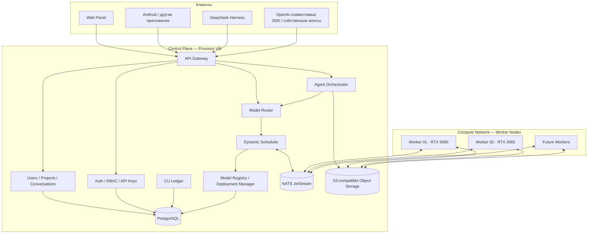
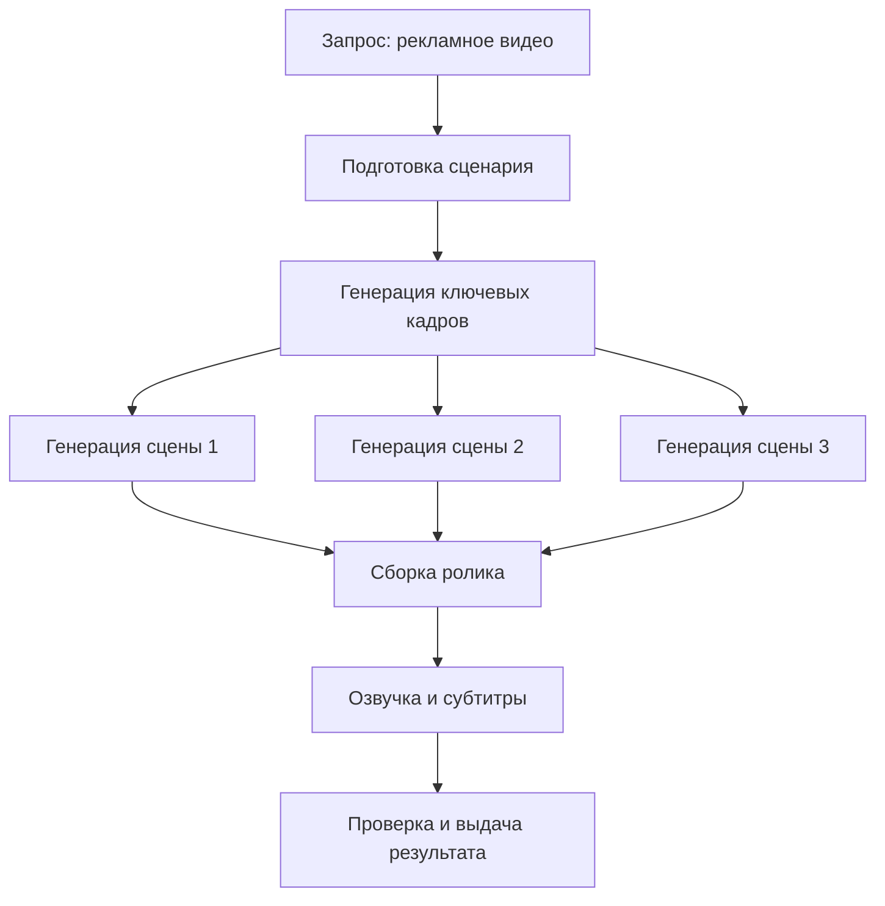
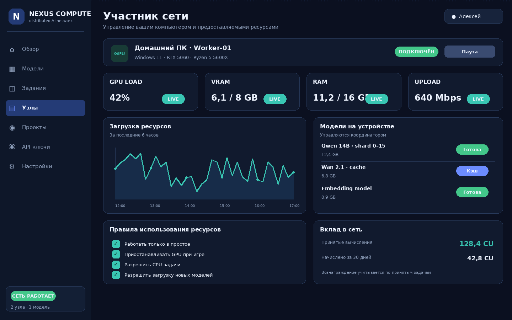
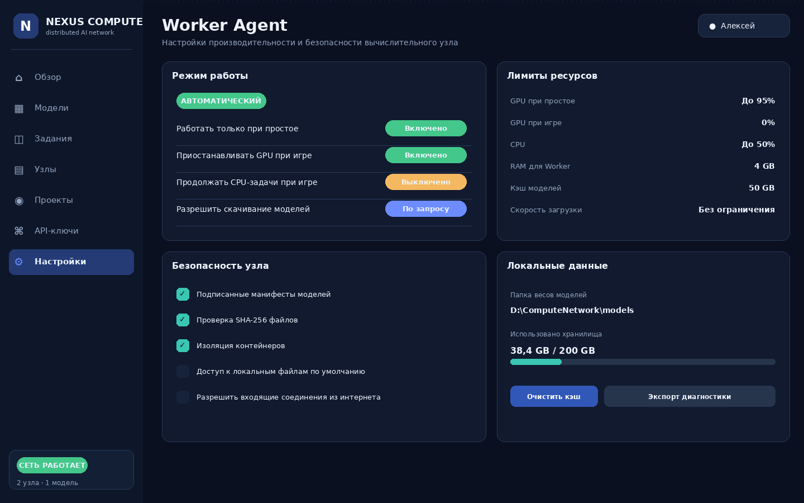
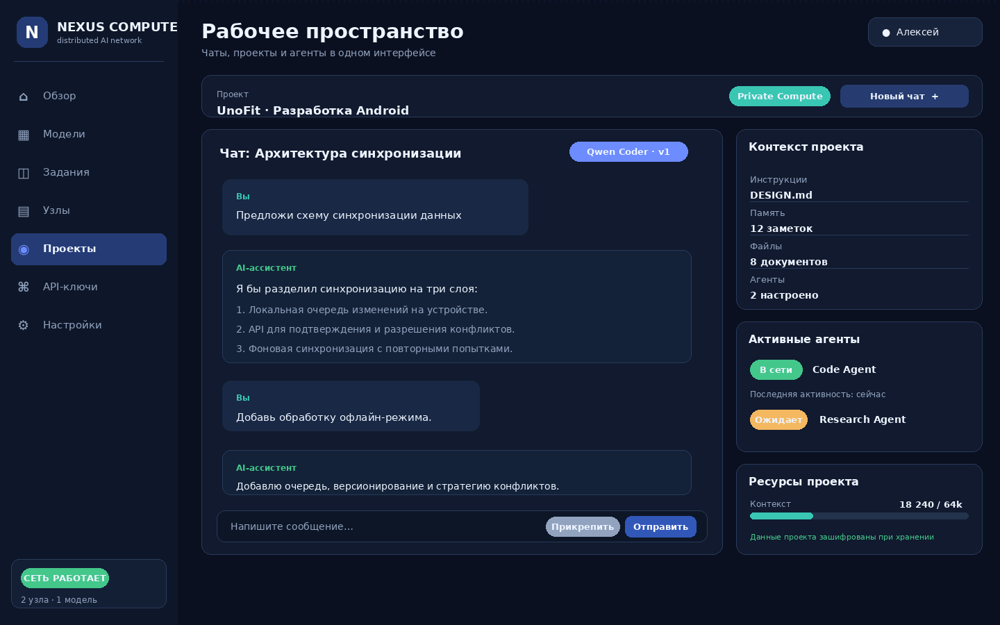
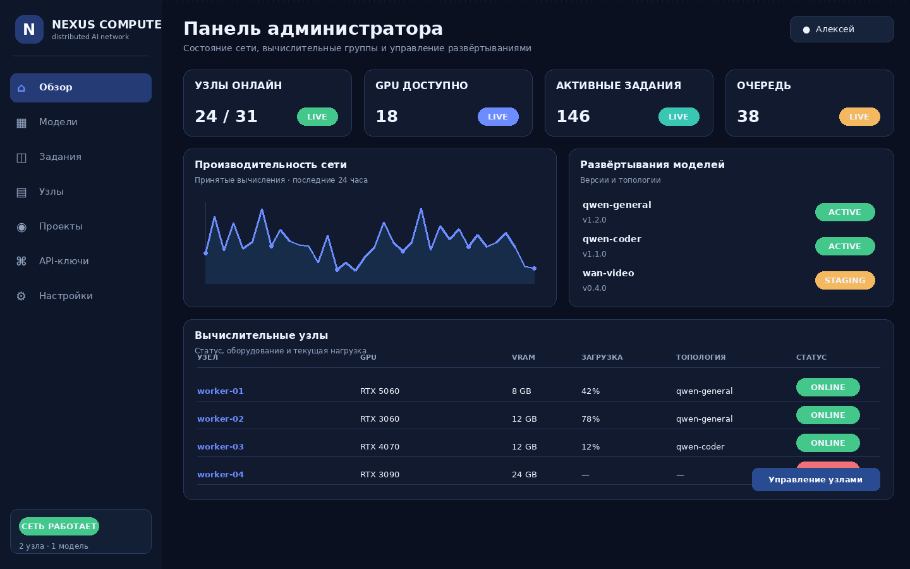
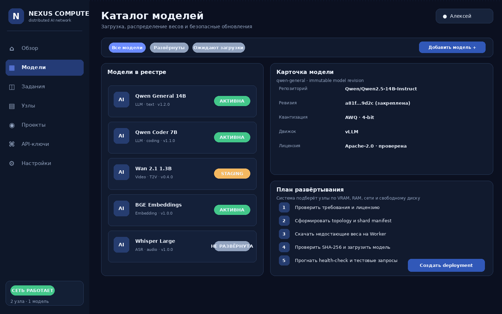
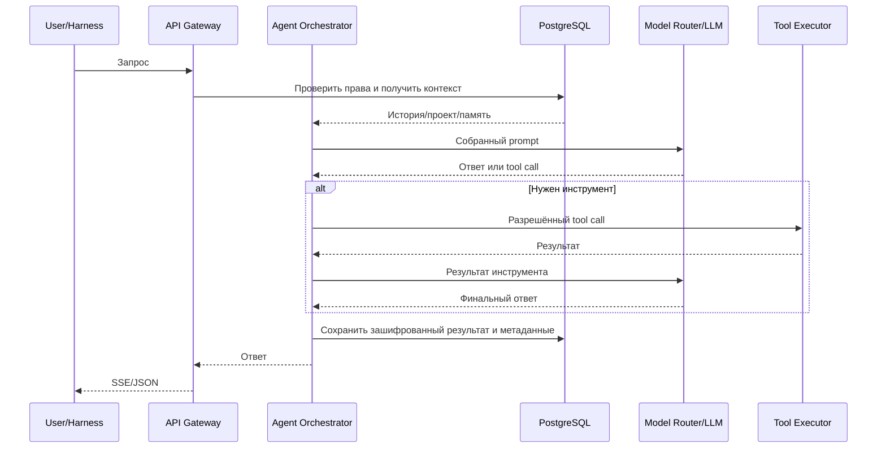

# Distributed AI Platform — архитектура и план реализации

**Статус документа:** исходное техническое задание и архитектурный план для первой реализации  
**Дата подготовки:** 5 ноября 2026 года  
**Рабочее название:** Distributed AI Platform / Compute Network  
**Основной язык управляющего backend:** Go  
**Основная инфраструктура:** существующий физический сервер Proxmox в РФ + компьютеры участников  

> Документ предназначен для передачи AI coding agent (DeepSeek Harness) в качестве основного контекста проекта. Это не требование реализовать всё за один проход. Агент должен двигаться по этапам, проверять состояние существующей инфраструктуры и не выполнять разрушительные операции без отдельного согласования.

> **Это исходное техническое задание, не описание текущей программы.** Как система работает сейчас: [`docs/how-it-works.md`](docs/how-it-works.md). Замеры и операционные заметки — в [`docs/STATUS.md`](docs/STATUS.md). При расхождении этого файла с `docs/how-it-works.md` верен `docs/how-it-works.md`. Домашний Proxmox из плана выведен. Адреса и сроки внутри текста ниже относятся к моменту написания и как актуальные не читаются.

---

## 0. Инструкция AI-агенту, который будет реализовывать проект

### 0.1. Главная задача

Создать частную расширяемую распределённую AI-платформу. Участники добровольно подключают свои компьютеры и предоставляют доступные CPU/GPU/RAM/SSD/сеть. Платформа объединяет ресурсы логически, управляет моделями, распределяет вычислительные задачи, предоставляет единый API и пользовательские рабочие пространства.

Пользователь должен иметь возможность:

- пользоваться общей LLM через веб-интерфейс, API или DeepSeek Harness;
- создавать независимые чаты, проекты и AI-агентов;
- хранить собственные файлы, инструкции, историю и память;
- не знать, на каком физическом компьютере выполняется запрос;
- не устанавливать вручную каждую модель и не распределять её слои самостоятельно.

Участник должен иметь возможность:

- подключить компьютер через Worker Agent;
- разрешить автоматическую загрузку только подходящих моделей/шардов;
- видеть загрузку, температуры, свободную память, модели и вклад;
- приостанавливать вычисления во время игр или работы;
- получать учёт вычислительного вклада в общую систему.

Администратор должен иметь возможность:

- управлять участниками, Worker, моделями, версиями, топологиями и заданиями;
- обновлять модели без остановки всего API;
- отслеживать производительность и ошибки;
- управлять политиками безопасности и доступом.

### 0.2. Обязательные правила разработки

1. **Сначала аудит, потом изменения.** Перед любыми изменениями Proxmox получить инвентаризацию текущих VM/CT, памяти, CPU, дисков, сетей, хранилищ и нагрузки. Не предполагать, что ресурсы свободны.
2. Не изменять существующие виртуальные машины, Docker-проекты, базы и сетевые конфигурации пользователя без явного отдельного разрешения.
3. Новую инфраструктуру разворачивать изолированно: отдельная VM `compute-control`, отдельные каталоги, отдельные базы и собственная сеть.
4. Не размещать большие модели на управляющей VM. Она не имеет GPU и не предназначена для инференса.
5. Не скачивать десятки гигабайт весов автоматически до проверки свободного места, источника, лицензии и согласия владельца Worker.
6. Не использовать неподписанные модели, контейнеры или скрипты от участников.
7. Не открывать Worker-порты напрямую в публичный интернет. Worker должен сам устанавливать исходящее защищённое соединение с Control Plane или работать через согласованную VPN-сеть.
8. Не логировать исходные сообщения, промпты, содержимое файлов, API-ключи, токены и приватные промежуточные данные.
9. Не выдавать за реализованное то, что не протестировано. Все результаты проверки должны иметь команды, версии, логи и критерии прохождения.
10. Сначала реализовать маленький вертикальный сценарий и автоматические тесты, затем расширять систему.
11. Все миграции БД должны быть версионированы и иметь процедуру резервного копирования/восстановления.
12. Не включать криптовалютные выплаты и собственный токен в MVP. На старте нужен только внутренний проверяемый учёт вклада.
13. Не вводить месячные пакеты сообщений, обязательную подписку или жёсткие пользовательские лимиты. Использовать общий вычислительный пул и мягкий fair-share scheduler. Технические ограничения безопасности, доступной памяти и очередей остаются необходимыми.
14. Не делать из Petals, vLLM, PyTorch Pipeline или любого одного Runtime единственную основу всей системы. Использовать адаптеры вычислительных движков.
15. До начала каждого этапа обновлять `docs/STATUS.md`, фиксировать архитектурные решения в `docs/adr/` и перечислять незакрытые риски.

### 0.3. Не делать в первой версии

- Не создавать собственную нейросеть и не обучать foundation model.
- Не создавать криптотокен.
- Не пытаться объединять видеопамять в одну физическую GPU.
- Не обещать ускорение одного запроса при каждом добавлении GPU.
- Не запускать Tensor Parallelism через произвольный домашний интернет без измерений и обоснования.
- Не отправлять приватные пользовательские запросы случайным/публичным участникам.
- Не подключать коммерческие закрытые модели (Kling, Seedance, Veo, Sora и т.п.) к чужим GPU без официального разрешения правообладателя/провайдера.
- Не разрабатывать собственный веб-чат до появления рабочего API и первого сценария с Harness; UI можно реализовать параллельно как отдельный этап после базовой интеграции.

---

# 1. Концепция и принципы

## 1.1. Что строим

Это **совместная распределённая вычислительная сеть с единым AI API и персональными рабочими пространствами**.

Она объединяет не сами GPU в одну физическую видеокарту, а доступные вычислительные ресурсы, модели, очереди и программные интерфейсы. Одна модель может быть:

1. полностью размещена на одном GPU;
2. скопирована на несколько узлов для параллельного обслуживания запросов;
3. разделена на части между несколькими GPU, если конкретная модель и Runtime поддерживают sharding/pipeline;
4. запущена как workflow из независимых задач, выполняемых разными узлами.

Пользователь обращается к стабильному API и выбирает логическое имя модели. Физическое размещение модели и выбор Worker выполняет координатор.

## 1.2. Ключевой принцип: общие веса, частные контексты

Веса нейросети могут быть общими для всех пользователей. История, память, проекты, файлы, системные инструкции и состояние агента — индивидуальны.

Разделять понятия:

- **Model Weights** — общие параметры модели;
- **Deployment/Topology** — где и как размещены веса;
- **KV Cache** — временное состояние конкретной генерации/сессии;
- **Conversation Storage** — постоянные чаты и сообщения;
- **Project Memory** — долговременный контекст конкретного проекта;
- **Agent State** — состояние конкретного агента и его задач.

Не смешивать KV Cache разных пользователей. Не использовать один общий prefix cache без tenant isolation. На MVP безопаснее отключить межпользовательское переиспользование KV/prefix cache; последующее включение разрешать только после отдельного threat-model и проверки настроек движка.

## 1.3. Пользовательские роли

Роль не должна быть жёстко привязана к одному человеку. Один аккаунт может одновременно быть потребителем AI и владельцем Worker.

- **Member / Contributor:** предоставляет CPU/GPU/память/диск/сеть.
- **AI User:** пользуется моделями, чатами, проектами и агентами.
- **Administrator:** управляет сетью и настройками.
- **Model Maintainer:** добавляет модели, ревизии и deployment-манифесты.
- **Auditor:** читает аудит и показатели, но не может менять конфигурацию.

Права выдаются через RBAC с минимально необходимыми полномочиями.

## 1.4. Базовая экономическая философия

Участник оплачивает пользование общей сетью вкладом собственного оборудования и ресурсов. Поэтому:

- нет обязательной подписки;
- нет фиксированного месячного пакета токенов;
- нет искусственного лимита количества сообщений;
- нет требования доплачивать за каждый обычный запрос;
- нет собственного токена в MVP;
- вклад учитывается прозрачно и влияет на приоритет при перегрузке;
- при нехватке ресурсов система ставит работу в очередь, а не обещает неограниченную мгновенную производительность.

**Важно:** отсутствие жёстких лимитов не означает физически бесконечные вычисления. Если спрос превышает доступную мощность, Scheduler распределяет приоритеты и очередь. Необходимо предусмотреть персональные защитные настройки: остановку Worker, максимальное потребление локального диска, запрет использования GPU во время игр и аварийный стоп. Это ограничения владельца оборудования и безопасности, а не коммерческие тарифные квоты.

---

# 2. Исходная инфраструктура и стартовые ограничения

## 2.1. Известные устройства

| Узел | Известные характеристики | Роль |
|---|---|---|
| Арендованный VPS, Москва (`144.31.61.208`) | KVM, 4 vCPU Xeon E5-2699 v4, 4 GB RAM, 120 GB SSD (109 GB свободно), 222 Mbit/s, публичный IPv4, домен `nshno.tech`, Ubuntu 24.04 LTS | **Control Plane — единственная площадка платформы** |
| Компьютер владельца | Windows 11, Ryzen 5 5600X, RTX 5060 8 GB, 16 GB RAM, замер upload ~1 Gbps, свободно `C:` 61 GB и `D:` 192 GB, используется для игр | Worker 01 |
| Компьютер напарника | RTX 3060 12 GB, другой дом; ОС/RAM/диск/сеть уточнить | Worker 02 |
| Домашний Proxmox (`46.181.198.226`) | Ryzen 5 3500X, 16 GB RAM, 1 TB + 500 GB, GPU GT 640 (Kepler) | **вне плана платформы** — обслуживает личный проект `Infocard` |

Требования к машине Control Plane (актуально): публичный IPv4 без CGNAT, KVM, ≥2 vCPU, ≥4 GB RAM, ≥100 GB диска, домен с возможностью выпуска сертификата. GPU не требуется.

Не делать предположений о свободных ресурсах любой площадки: инвентаризация выполняется командами из `scripts/pve-audit.sh` / `docs/operations/`, результаты фиксируются в `docs/operations/`.

## 2.2. Конфигурация управляющего узла

Фактически развёрнутая конфигурация (2026-11-05):

| Ресурс | Значение |
|---|---|
| Площадка | арендованный VPS, Москва, `144.31.61.208` |
| ОС | Ubuntu 24.04.4 LTS, KVM |
| CPU | 4 vCPU |
| RAM | 4 GB (платформа занимает ~0.02 GB, остальное — действующий проект владельца) |
| Диск | 120 GB, занято ~7 GB |
| GPU | Не требуется |
| Публикация | nginx, TLS Let's Encrypt, домены `api.nshno.tech` / `control.nshno.tech` |
| Внутренние порты | API `127.0.0.1:8090`, PostgreSQL `127.0.0.1:5432`, NATS `127.0.0.1:4222` |

Требования при смене площадки: публичный IPv4 без CGNAT, KVM (не OpenVZ), ≥2 vCPU, ≥4 GB RAM, ≥100 GB диска, возможность выпуска сертификата на домен. Разворачивание — `scripts/vps-control-plane.sh` (идемпотентно).

Не отбирать память и диск у уже работающих сервисов: платформа обязана уживаться рядом (отдельная БД, отдельные порты, отдельные каталоги, отдельные бэкапы).

## 2.3. Свободное место на Worker

Модели могут занимать от нескольких гигабайт до десятков и сотен гигабайт. Объём зависит от модели, precision/quantization, Runtime, текстовых энкодеров, VAE, кэша и промежуточных файлов.

Worker должен:

- сообщать свободное место по каждому диску;
- иметь настраиваемый каталог кэша;
- получать план загрузки до скачивания;
- скачивать только необходимые компоненты/шарды;
- поддерживать возобновление загрузки;
- удалять только неиспользуемый кэш после проверки, что модель не закреплена за активным deployment;
- не удалять пользовательские файлы.

Для начального LLM PoC нужно сначала освободить место и проверить, какая часть модели потребуется. Не требовать сразу 250 GB от каждого участника. Для дальнейшего видеонаправления планировать существенно больший запас SSD, но точное требование определять по выбранным моделям и workflow.

---

# 3. Архитектура системы

## 3.1. Четыре логических уровня



## 3.2. Control Plane

Работает на Proxmox VM. GPU не использует.

Компоненты:

1. **API Gateway:** внешний единый адрес, TLS, маршрутизация, аутентификация, потоковая выдача, request ID, совместимость с клиентами.
2. **Auth Service:** пользователи, сессии, MFA в будущем, API-ключи, scopes, отзыв ключей.
3. **User/Project Service:** проекты, чаты, сообщения, настройки и права доступа.
4. **Agent Orchestrator:** циклы агентов, контекст, вызовы инструментов, статусы.
5. **Model Router:** логическое имя модели → активный deployment → подходящая группа Worker.
6. **Scheduler:** подбор исполнителей и распределение задач.
7. **Model Registry:** модели, версии, лицензии, манифесты, контрольные суммы, требования и топологии.
8. **Deployment Manager:** подготовка и переключение новых версий, rollback, drain старых сессий.
9. **Accounting/Ledger:** учёт вклада и потребления в CU.
10. **Validator:** проверка результатов и контрольные задания.
11. **Monitoring/Audit:** метрики, события, аудит без содержимого приватных запросов.

## 3.3. Data Plane

На компьютерах участников:

- Worker Agent;
- Hardware Discovery;
- Local Model Manager;
- Runtime Adapter;
- Container/Process Supervisor;
- Resource Governor;
- Local Cache;
- Metrics Agent.

Worker не должен самостоятельно принимать произвольные задания из публичного интернета. Он получает подписанную аренду (lease) задачи от Control Plane, проверяет её, запускает разрешённый Runtime и отправляет результаты по защищённому каналу.

## 3.4. Управляющий сервер не должен быть узким местом

Тяжёлые веса, видеоданные и промежуточные тензоры не должны без необходимости проходить через Proxmox.

Control Plane передаёт метаданные, задания, ссылки/временные разрешения на объекты, топологии и команды. Большие файлы передаются напрямую через объектное хранилище или разрешённый peer-to-peer канал с проверкой подписи и SHA-256.

Для первого этапа допустимо, что файлы проходят через S3-хранилище. Нельзя строить архитектуру, где Proxmox VM становится обязательным прокси для каждого байта GPU-трафика.

---

# 4. Режимы вычислений и распределение моделей

Система должна поддерживать несколько способов размещения модели. Не все модели поддерживают каждый режим.

## 4.1. Replicated Inference — копии модели

Полная копия модели запускается на нескольких GPU/группах. Router распределяет независимые запросы между репликами.

Использовать, если модель помещается в память отдельного Worker или группы.

Преимущества:

- лучше увеличивает суммарную пропускную способность;
- меньше сетевых переходов внутри одного запроса;
- проще масштабировать число одновременных пользователей;
- отказ одного узла не обязательно останавливает остальные.

Минус: веса дублируются и занимают место на каждом узле.

## 4.2. Model Sharding / Pipeline Parallelism

Одна модель разделяется на блоки/слои, размещённые на разных GPU. Промежуточные активации передаются между стадиями.

Использовать, когда модель не помещается на одной GPU и конкретный Runtime/модель поддерживает такое размещение.

Преимущество — можно запустить модель, которая не помещается на одной карте.

Ограничение — это не гарантирует увеличение скорости одного ответа. При последовательной генерации токен проходит по всем стадиям. Дополнительные узлы и сетевые переходы могут увеличить задержку. Pipeline обычно полезнее для размещения большой модели и повышения throughput при нескольких активных последовательностях.

## 4.3. Tensor Parallelism

Разделяет матричные операции внутри слоя между GPU. Требует частого обмена данными.

Для удалённых домашних GPU через WAN не использовать как режим по умолчанию. Рассматривать только для узлов в одной быстрой локальной сети с измеренной пропускной способностью и низкой задержкой.

## 4.4. Independent Compute / Batch Tasks

Каждый Worker выполняет независимую часть задания: изображение, аудиофайл, сцену видео, документ, фрагмент транскрибации.

Это наиболее удобный режим для разнесённых по домам компьютеров и мультимодальных задач.

## 4.5. Distributed Workflow

Workflow Engine разбивает пользовательскую задачу на зависимые этапы. Каждый этап может использовать свой Runtime/модель.

Пример:



## 4.6. Выбор режима автоматически

Scheduler учитывает:

- архитектуру и поддержку модели;
- VRAM и свободную VRAM;
- RAM и свободную RAM;
- свободное место на SSD;
- производительность узла на конкретном типе задания;
- RTT/jitter/loss между стадиями;
- загрузку GPU/CPU;
- текущие leases;
- доступность узла и доверительный класс;
- наличие нужной ревизии модели и Runtime.

Новый участник не должен автоматически получать часть каждой модели. Scheduler решает: добавить shard, создать реплику, отправить независимые задания или оставить узел свободным до подходящей работы.

---

# 5. Model Registry и автоматическая загрузка весов

## 5.1. Назначение

Model Registry — каталог моделей и неизменяемых ревизий. Для каждого логического model ID хранить:

- имя и описание;
- тип: LLM, embedding, vision, image generation, video generation, ASR, audio;
- исходный репозиторий;
- точную revision/commit hash;
- лицензию и статус проверки лицензии;
- формат весов и quantization;
- Runtime и совместимую версию;
- список файлов и SHA-256;
- требования к GPU/VRAM/RAM/диску;
- список поддерживаемых операций;
- способ размещения: replica/sharded/workflow;
- mapping слоёв/тензоров на Worker;
- deployment history.

## 5.2. Нельзя просто разрезать любой файл модели на части

Части checkpoint-файла и вычислительные части модели — не одно и то же.

Для каждого Runtime/модели нужен адаптер, который знает, как:

- определить архитектуру и структуру слоёв;
- подготовить shard manifest;
- назначить блоки Worker;
- загрузить их в правильном порядке;
- проверить совместимость и контрольные суммы;
- создать pipeline;
- корректно освободить ресурсы.

Если модель не поддерживает sharding в выбранном движке, можно использовать только полные реплики или независимые workflow-задачи.

## 5.3. Процесс загрузки

1. Администратор добавляет модель из разрешённого источника.
2. Система проверяет метаданные и лицензию.
3. Модель получает pinned revision.
4. Model Registry создаёт manifest.
5. Scheduler подбирает Worker.
6. Worker проверяет локальный cache и свободный диск.
7. Если данных нет, загрузка возобновляемая, с ограничением дискового бюджета участника.
8. Проверяется SHA-256 каждого файла/шарда.
9. Подготавливается локальное размещение.
10. Runtime загружает модель в память.
11. Health-check и тестовый inference.
12. Deployment становится `READY`, затем может быть активирован.

## 5.4. Источники и лицензии

Поддержать Hugging Face Hub и собственное S3-хранилище. Загрузка с Hugging Face должна фиксировать commit hash, а не скачивать плавающую ветку `main` без закрепления версии.

**Лицензия обязательна к проверке.** Наличие открытых весов не означает право на любое коммерческое использование, перепаковку или распространение. Условия лицензии конкретной модели должны быть приняты и зафиксированы. P2P-передача весов между участниками разрешается только если лицензия допускает такое распространение. По умолчанию участник может получать нужные файлы напрямую из исходного репозитория, а не от другого участника.

## 5.5. Хранилище модели на Worker

Пример локальной структуры:

```text
ComputeNetwork/
  agent/
  models/
    qwen-general/
      revision-a81f.../
        manifest.json
        shards/
          shard-0001.safetensors
          shard-0002.safetensors
        checksums.sha256
    qwen-coder/
    embeddings/
  runtime-cache/
  task-cache/
  logs/
```

Не хранить API-ключи, пользовательские чаты и приватные документы в каталоге моделей.

---

# 6. Динамическое подключение узлов и управление топологией

## 6.1. Регистрация нового Worker

1. Пользователь регистрируется в Web Panel.
2. Нажимает «Добавить устройство».
3. Получает одноразовый enrollment token.
4. Устанавливает Worker Agent.
5. Worker создаёт локальный ключ устройства.
6. Отправляет token и публичный ключ по TLS.
7. Control Plane проверяет одноразовый токен и выдаёт сертификат устройства.
8. Worker проводит hardware discovery и benchmark.
9. Участник выбирает режим доступности и доверительный класс.
10. Scheduler определяет, какие задания и модели подходят узлу.

Enrollment token одноразовый, короткоживущий, привязан к аккаунту и не должен храниться в логах.

## 6.2. Heartbeat

Worker периодически отправляет:

- worker_id;
- agent_version;
- uptime;
- CPU/GPU utilization;
- VRAM/RAM free;
- температуры и power telemetry, если доступно;
- free disk;
- сетевые показатели;
- список локальных model revisions;
- текущие jobs/leases;
- состояние пользователя: available/paused/maintenance/gaming.

Частоту heartbeat сделать настраиваемой. Не опрашивать слишком часто, чтобы не создавать лишнюю нагрузку.

## 6.3. Перераспределение весов

При подключении третьего/четвёртого GPU не обязательно скачивать всю модель заново.

Возможные действия:

- назначить новому узлу недостающие слои;
- создать дополнительную реплику существующего deployment;
- использовать его для независимых задач;
- оставить узел в резерве.

**Нельзя менять активную топологию на месте без плана миграции.** Создаётся `topology-vN+1`, загружаются недостающие веса, выполняются проверки. Новые запросы переводятся на новую топологию. Старые сессии завершаются на старой топологии. После drain старая топология освобождает VRAM.

Если ресурсов для Blue-Green недостаточно, API и пользовательские данные остаются доступными, но конкретный model pool может перейти в короткий maintenance/queue режим. Нельзя обещать безостановочную замену модели, если обе версии не помещаются в доступный пул.

## 6.4. Отказ узла

- Lease имеет TTL и heartbeat.
- При потере Worker Scheduler перестаёт выдавать ему новые задания.
- Незавершённое независимое задание возвращается в очередь после окончания lease.
- Идемпотентный task ID предотвращает двойное начисление.
- Pipeline-сессия, потерявшая одну стадию, помечается как interrupted. По возможности запрос повторяется на другой топологии; иначе пользователю возвращается контролируемая ошибка и сессия может быть возобновлена из сохранённой истории без переноса несовместимого KV Cache.

---

# 7. Worker Agent — настольная программа участника

## 7.1. Цель

Пользователь не должен самостоятельно устанавливать Docker, Python, PyTorch, CUDA Runtime и модели вручную для обычного подключения. Worker Agent должен автоматизировать проверку и установку совместимых компонентов, показывать требования и спрашивать согласие до крупных загрузок.

Первые платформы:

- Windows 11 — первый пользовательский компьютер;
- Linux Ubuntu — для узлов с лучшей поддержкой контейнеров и GPU;
- Windows Worker может использовать поддерживаемый GPU runtime/WSL2, но совместимость конкретного Runtime проверять отдельно.

## 7.2. Состав Worker Agent

- Core Service — Go, системная служба.
- Tray/Desktop UI — отдельный интерфейс пользователя.
- Hardware Discovery — NVIDIA NVML/nvidia-smi, CPU, RAM, диски, сеть.
- Model Manager — скачивание/проверка/кэширование весов.
- Runtime Adapter — запускает выбранный движок.
- Container Supervisor — запуск подписанных контейнеров/задач.
- Resource Governor — пауза, лимиты локального потребления, температура, игры.
- Diagnostics Exporter — формирует пакет диагностики без приватного содержимого.

## 7.3. Экран Worker — кнопки и функции



### Верхняя карточка устройства

| Элемент | Действие |
|---|---|
| Название устройства | Открывает редактирование имени Worker, например `Домашний ПК` |
| Статус «Подключён» | Показывает, что Control Plane получает heartbeat и сертификат действителен |
| «Пауза» | Немедленно прекращает брать новые задания; активные безопасные задачи завершаются либо отменяются по политике участника |
| «Возобновить» | Возвращает Worker в состояние `available`, после проверки температуры, памяти и соединения |
| «Режим обслуживания» | Выводит узел из Scheduler, но сохраняет регистрацию и локальный кэш |
| «Переподключить» | Повторяет handshake и проверку сертификата, не создаёт новый Worker ID |

### Карточки ресурсов

- **GPU LOAD:** текущая загрузка GPU; клик открывает историю по времени, активные jobs и температуру.
- **VRAM:** занятая/свободная видеопамять; клик показывает, какие локальные deployments и процессы используют память.
- **RAM:** использование оперативной памяти; показывает резерв для Worker и доступную память ОС.
- **UPLOAD/DOWNLOAD:** фактическая пропускная способность; клик показывает тест сети и передачу файлов.
- **Температура:** показывать отдельно, если доступно через NVML. При превышении пользовательского безопасного порога — временно приостанавливать новые GPU-задачи.
- **Энергопотребление:** показывать GPU power draw, если устройство сообщает данные. Не подменять фактическое потребление всей системы оценкой GPU.

### «Модели на устройстве»

Для каждой модели отображать:

- logical model ID;
- версию/revision;
- назначенный shard или роль replica;
- размер на диске;
- текущий статус: `queued`, `downloading`, `verifying`, `ready`, `loaded`, `error`, `unused`;
- кнопку «Подробнее» — манифест, требования, лицензия, SHA-256;
- кнопку «Приостановить загрузку»;
- кнопку «Повторить» при ошибке;
- кнопку «Очистить кэш» только для неиспользуемых файлов;
- кнопку «Запретить эту модель» — исключить конкретную модель с данного узла.

Не позволять вручную удалить активный shard без drain и подтверждения.

### «Правила использования ресурсов»

| Переключатель | Функция |
|---|---|
| Работать только в простое | Worker получает GPU-задания, только когда компьютер не используется по заданным правилам |
| Приостанавливать GPU при игре | Обнаруживает заданные пользователем игровые процессы и/или высокий интерактивный GPU usage; приостанавливает выдачу новых задач |
| Продолжать CPU-задачи при игре | Разрешает CPU-задачи в период игровой сессии, если владелец включил настройку |
| Разрешить загрузку моделей | Разрешает Model Manager автоматически загружать одобренные модели после показа размера и проверки свободного места |
| Разрешить независимые задания | Включает обработку независимых jobs |
| Разрешить участие в распределённой модели | Разрешает выделять узлу shard/стадии модели; показывается предупреждение о доверии к промежуточным тензорам |
| Разрешить публичный compute | По умолчанию выключено; включает только задания, помеченные как безопасные для публичных узлов |

У каждого переключателя должна быть подсказка, описание рисков и сохранение после нажатия «Применить».

### Экран «Настройки Worker»



| Кнопка/поле | Функция |
|---|---|
| «Запускать вместе с Windows» | Управляет автозапуском системной службы/Tray; по умолчанию включено только после согласия пользователя |
| «Работать только в простое» | Переключатель с настройкой задержки простоя и перечнем исключений |
| «Пауза при игре» | Настройка списка процессов, порога GPU utilization и ручной паузы |
| «GPU usage» | Локальный максимум использования GPU при простое; это ограничение владельца, не квота платформы |
| «CPU usage» | Локальный предел CPU-задач |
| «RAM reserve» | Память, которую Worker обязан оставить ОС и другим приложениям |
| «Model cache directory» | Выбор диска/папки для весов |
| «Model cache budget» | Максимальный объём автоматического кэша |
| «Очистить кэш» | Удаляет только незакреплённые модели и временные файлы, показывает список до подтверждения |
| «Проверить обновления» | Проверяет новую версию Worker Agent; установка выполняется после проверки подписи |
| «Экспорт диагностики» | Создаёт архив технической диагностики без чатов, файлов, токенов и API-ключей |
| «Отвязать устройство» | Сначала drain, удаление сертификата/ключа из сервера, удаление служебных данных; модели по выбору владельца сохраняются или удаляются |

### Ресурсная безопасность

- Не запускать работу при перегреве/ошибках GPU.
- Не использовать GPU, когда участник нажал Pause.
- Не скачивать модели без согласия и места.
- Не выполнять произвольный shell от имени администратора.
- Не монтировать весь диск пользователя внутрь контейнера.
- Не разрешать Worker самостоятельно подменять задания, Runtime или manifest.

---

# 8. Пользовательский Web Workspace

Полноценный чат-интерфейс нужен, но не блокирует первый технический прототип: на ранней стадии основным клиентом может быть DeepSeek Harness.



## 8.1. Главная навигация

| Пункт | Функция |
|---|---|
| «Обзор» | Сводка проектов, последних чатов, задач и состояния сети |
| «Модели» | Каталог доступных моделей, описание возможностей и выбор модели по умолчанию |
| «Задания» | Пользовательские длительные задачи, статусы и результаты |
| «Узлы» | Если пользователь также участник — его Worker; в обычном пользовательском режиме раздел можно скрыть |
| «Проекты» | Создание и управление рабочими пространствами с отдельными инструкциями и файлами |
| «API-ключи» | Создание, просмотр метаданных, ротация и отзыв ключей; секрет показывать один раз при создании |
| «Настройки» | Аккаунт, безопасность, устройства, экспорт и удаление данных |

## 8.2. Верхняя панель проекта

| Элемент | Функция |
|---|---|
| Выбор проекта | Переключает изолированное пространство, его инструкции, файлы, память и агенты |
| «Новый чат» | Создаёт новую conversation в текущем проекте |
| Выбор модели | Выбирает logical model ID. Не показывает физические GPU и shard map обычному пользователю |
| Статус приватности | Показывает режим: `Private Trusted Pool`, `Local Only` или `Public Safe Tasks`; пользователь видит, где разрешено исполнять данные |
| «Настройки проекта» | Инструкции, список агентов, доступ к файлам, память, участники проекта |

## 8.3. Чат

Кнопки и функции:

- **Отправить:** отправляет сообщение и начинает stream ответа.
- **Остановить генерацию:** отменяет текущий запрос и корректно освобождает ресурсы; уже сохранённые сообщения не удаляются.
- **Повторить:** повторно отправляет последний запрос с теми же параметрами или открывает выбор изменений.
- **Изменить сообщение:** редактирует исходное сообщение и создаёт новую ветку диалога, не уничтожая предыдущую.
- **Копировать:** копирует выбранный ответ; действие фиксируется только в клиенте.
- **Прикрепить файл:** загружает файл в текущий проект, проверяет тип/размер, шифрует и связывает с сообщением.
- **Добавить в память:** пользователь явно подтверждает сохранение факта/заметки в память проекта или профиля.
- **Создать задачу из ответа:** сохраняет план/действие как отдельную задачу Orchestrator.
- **Выбор агента:** запускает конкретный профиль агента с разрешёнными инструментами.
- **Развернуть детали:** показывает model ID/version, request ID, время, token usage и статус вычисления; не показывает секретные внутренние данные других пользователей.
- **Оценить ответ:** необязательная обратная связь; не используется для автоматического изменения приватной памяти без согласия.

Поле ввода должно поддерживать Markdown, вложения, многострочный текст, отмену и продолжение. Не выполнять инструменты только потому, что модель их упомянула: инструмент должен быть явно оформлен как tool call и проверен политикой доступа.

## 8.4. Правая панель «Контекст проекта»

- **Инструкции:** открыть/редактировать system/project instructions с версионированием.
- **Память:** список сохранённых заметок; кнопки «Добавить», «Изменить», «Удалить», «Экспортировать».
- **Файлы:** список загруженных файлов; «Загрузить», «Скачать», «Переиндексировать», «Удалить».
- **Агенты:** список настроенных агентов; «Создать», «Настроить», «Запустить», «Остановить», «История запусков».
- **Ресурсы проекта:** показывает размер файлов, количество записей и контекстные показатели. Не выдаёт внутренние токены KV Cache за постоянную память проекта.

## 8.5. Проекты и доступ

Каждый проект имеет:

- уникальный ID;
- владельца и список участников;
- role permissions;
- инструкции;
- набор разрешённых агентов;
- список файлов;
- собственную память;
- чаты;
- журнал действий;
- политику хранения данных.

Общий Model Weights не означает общую память проектов.

---

# 9. Кабинет администратора



## 9.1. Dashboard

Показывает:

- количество зарегистрированных Worker;
- сколько онлайн/оффлайн/на паузе;
- доступные GPU и суммарную доступную VRAM;
- загрузку CPU/GPU;
- число активных задач и очередь;
- активные модели и deployment;
- ошибки и предупреждения;
- вычислительную работу за период;
- задержки API и inference.

Показатели должны рассчитываться по фактическим данным. Не показывать демонстрационные/условные данные в production.

### Кнопки Dashboard

- **«Обновить»** — запросить свежие метрики.
- **«Экспорт отчёта»** — CSV/JSON без пользовательского содержимого.
- **«Все узлы»** — перейти к таблице Worker.
- **«Очередь»** — посмотреть задания, задержки и причины ожидания.
- **«Аварийный режим»** — отключить выдачу новых jobs всему пулу; требует подтверждения и записи в audit log.

## 9.2. Раздел «Узлы»

Таблица:

- Worker ID;
- владелец;
- ОС/версия Worker;
- CPU/GPU;
- VRAM/RAM;
- свободный диск;
- сеть/RTT;
- текущая загрузка;
- модели/шарды;
- trust class;
- статус.

Кнопки карточки Worker:

- «Подробнее» — графики, Hardware Discovery, heartbeat, логи.
- «Пауза» — stop выдачи новых заданий.
- «Drain» — дождаться завершения активных задач и вывести узел.
- «Карантин» — запретить новые задачи и изолировать узел при подозрении на компрометацию.
- «Отозвать сертификат» — инвалидировать идентичность устройства; необратимо до повторной регистрации.
- «Изменить trust class» — только с подтверждением и аудитом.
- «Переназначить модель» — создаёт новую topology, не меняет работающий deployment сразу.
- «Экспорт диагностики» — только технические данные.

## 9.3. Раздел «Модели / Model Registry»



Кнопки:

- **«Добавить модель»** — открыть wizard добавления из Hugging Face/S3/локального approved artifact.
- **«Проверить лицензию»** — обязательный шаг перед публикацией модели в каталоге.
- **«Получить метаданные»** — читать конфигурацию, архитектуру и файлы из источника.
- **«Зафиксировать revision»** — закрепить commit hash/версию.
- **«Рассчитать требования»** — оценить disk/RAM/VRAM для выбранного Runtime/quantization.
- **«Предпросмотр deployment»** — показать, какие Worker подходят и сколько данных потребуется скачать.
- **«Создать deployment»** — сформировать staging deployment.
- **«Тестировать»** — выполнить smoke tests и нагрузочный benchmark.
- **«Активировать»** — перенаправить новые запросы на выбранную версию после проверок.
- **«Rollback»** — вернуться к предыдущему здоровому deployment.
- **«Архивировать»** — скрыть модель из новых выборов, не удаляя её из активных сессий.
- **«Удалить веса»** — только после проверки, что ни один deployment/Worker не использует данные; требуется подтверждение.

Карточка модели должна показывать:

- model ID и display name;
- источник и pinned revision;
- license status;
- runtime/версию;
- quantization;
- список artifacts, размеры и hashes;
- архитектуру;
- поддерживаемые режимы;
- hardware constraints;
- deployment/topology;
- дату последней проверки.

## 9.4. Раздел «Deployments / Topology»

Показывает физическое размещение частей модели, связи между стадиями, latency и состояние каждой стадии.

Кнопки:

- «Новая топология» — создать draft.
- «Добавить Worker» — выбрать узел и роль.
- «Назначить shard» — задать поддерживаемый диапазон блоков/тензоров через adapter.
- «Добавить replica» — создать дополнительную копию модели.
- «Проверить сеть» — измерить RTT, throughput, loss.
- «Проверить память» — проверить фактический запас VRAM/RAM.
- «Сохранить draft» — сохранить конфигурацию без запуска.
- «Развернуть staging» — загрузить недостающие веса.
- «Smoke test» — короткий inference/validation.
- «Canary 5%» — направить часть новых запросов на новую версию, если deployment допускает это.
- «Активировать 100%» — переключить новые запросы.
- «Drain old deployment» — завершить старые сессии.
- «Rollback» — вернуть предыдущую конфигурацию.

## 9.5. Раздел «Задания»

Показывает task ID, тип, модель, срок lease, попытки, исполнитель, статус, время выполнения, объём данных, проверку и начисление CU.

Кнопки:

- «Подробнее» — payload metadata без приватного prompt, lease и result state.
- «Повторить» — повторно поставить только идемпотентную/безопасную задачу.
- «Отменить» — отменить задачу с фиксацией причины.
- «Переназначить» — вернуть в очередь после окончания текущего lease.
- «Проверить результат» — запустить Validator или ручную проверку.
- «Показать аудит» — действия, но без содержимого приватных сообщений.

## 9.6. Раздел «Экономика / CU»

Показывает:

- вклад каждого участника;
- принятые вычислительные единицы;
- использование общей сети;
- агрегированную нагрузку;
- корректировки и причины;
- историю операций.

Кнопки:

- «Экспорт CSV»;
- «Детали начисления»;
- «Корректировка» — только с причиной, правом администратора и audit event;
- «Пересчитать» — для исправления версии benchmark или формулы, с версионированием и сохранением прежнего ledger.

Не допускать скрытых ручных правок баланса.

## 9.7. Раздел «Безопасность»

- просмотр событий авторизации;
- активные сессии;
- API-ключи (только метаданные, без повторного показа секрета);
- Worker certificates;
- ротация ключей;
- аудит действий администраторов;
- trust classes;
- инциденты.

Кнопки «Отозвать ключ», «Завершить сессию», «Карантин узла», «Ротация ключей» всегда требуют подтверждения и записываются в audit log.

---

# 10. API и подключение внешних клиентов

## 10.1. Единый Base URL

Публичный адрес после настройки домена:

```text
https://api.<PROJECT_DOMAIN>/v1
```

Не привязывать клиента к IP Worker, конкретной видеокарте, Petals DHT или внутреннему адресу vLLM.

## 10.2. Протокол

MVP: OpenAI-compatible Chat Completions с SSE streaming.

В последующих версиях:

- OpenAI Responses API;
- Anthropic Messages API;
- embeddings;
- audio transcription;
- image/video task APIs.

vLLM публикует OpenAI-compatible endpoints для Chat Completions, Responses, Embeddings и Transcriptions, но фактическая доступность зависит от выбранного Runtime/model task. API Gateway не должен обещать неподдерживаемый endpoint. См. [vLLM OpenAI-Compatible Server](https://docs.vllm.ai/en/latest/serving/openai_compatible_server.html).

## 10.3. Минимальный публичный API MVP

| Метод | Endpoint | Назначение |
|---|---|---|
| GET | `/v1/models` | Каталог доступных логических моделей |
| POST | `/v1/chat/completions` | Генерация текста, streaming/non-streaming |
| GET | `/v1/health` | Только безопасный health endpoint; не раскрывать внутренние детали |
| GET | `/v1/usage` | Собственная статистика ключа/аккаунта, без чужих данных |

Следующий этап:

| Метод | Endpoint | Назначение |
|---|---|---|
| POST | `/v1/responses` | Responses protocol для совместимых клиентов |
| POST | `/v1/embeddings` | Векторизация |
| POST | `/v1/audio/transcriptions` | ASR |
| POST | `/v1/images/generations` | Создание изображения как async task |
| POST | `/v1/videos/generations` | Создание видео как async task |
| GET | `/v1/tasks/{task_id}` | Статус длительной задачи |
| POST | `/v1/tasks/{task_id}/cancel` | Отмена задачи |

Admin API не должен находиться в публичном `/v1` namespace.

## 10.4. Пример Chat Completions запроса

```json
{
  "model": "qwen-general",
  "messages": [
    {"role": "system", "content": "Ты технический помощник проекта."},
    {"role": "user", "content": "Объясни архитектуру очереди."}
  ],
  "stream": true,
  "temperature": 0.4
}
```

Model ID — логический alias, который Model Router связывает с active deployment. Пользователь не передаёт ID физического Worker.

## 10.5. API Keys

- Создание ключа в User Panel.
- Ключ показывается один раз.
- В БД хранить только salted hash или безопасный keyed hash, не исходный секрет.
- Поддержать scopes, например `models:read`, `chat:write`, `files:read`, `tasks:read`.
- Ротация, отзыв, дата последнего использования.
- Отдельные ключи для Harness, Android и автоматизации.
- Не использовать API key участника Worker для доступа к пользовательским данным.

## 10.6. Административный API

Пример namespace:

```text
/admin/v1/workers
/admin/v1/models
/admin/v1/deployments
/admin/v1/topologies
/admin/v1/tasks
/admin/v1/audit
/admin/v1/metrics
```

Требования:

- только администратор/разрешённая VPN;
- отдельные scopes;
- журналирование;
- CSRF protection для браузерной сессии;
- MFA для админов в следующем этапе;
- запрет доступа к исходным чатам через обычные admin endpoints.

## 10.7. Worker Control API

Внутренний namespace, доступный только по защищённому каналу и сертификату Worker:

```text
/worker/v1/enroll
/worker/v1/heartbeat
/worker/v1/capabilities
/worker/v1/leases/claim
/worker/v1/leases/{id}/heartbeat
/worker/v1/leases/{id}/complete
/worker/v1/leases/{id}/fail
/worker/v1/artifacts/manifest
/worker/v1/artifacts/presign
/worker/v1/diagnostics
```

Фактический контракт оформить OpenAPI спецификацией. Не отдавать Worker весь объект задания, если ему нужна только часть данных. Для приватных LLM-запросов Worker получает минимум необходимого контекста через доверенный Inference path.

---

# 11. DeepSeek Harness и другие AI-агенты

## 11.1. Подключение Harness

В актуальной документации DeepSeek Harness предусмотрено добавление `Custom model API` в Settings → Models. Пользователь задаёт Provider ID, Base URL, API Protocol, credential и список моделей. Поддерживаются OpenAI Chat Completions, OpenAI Responses и Anthropic Messages. См. [DeepSeek Harness — Configure models](https://deepseek-harness.github.io/deepseek-harness/en/guide/providers).

Пример пользовательской настройки:

| Поле Harness | Значение |
|---|---|
| Provider ID | `private-compute` |
| Display Name | `Private Compute Network` |
| Base URL | `https://api.<PROJECT_DOMAIN>/v1` |
| API Protocol | OpenAI Chat Completions на MVP |
| API Key | персональный ключ, выпущенный в нашей панели |
| Model ID | `qwen-coder` или другой alias из `/v1/models` |

Provider ID у Harness постоянный; если его нужно переименовать, документация рекомендует создать новый provider и удалить старый. Модели можно получать через Fetch available models, если endpoint поддерживает совместимый список; иначе ID указывается вручную.

**Важно:** реализовать совместимость на нашей стороне и затем проверить реальные запросы Harness. Нельзя считать интеграцию готовой только потому, что API возвращает похожий JSON.

## 11.2. Что делает Harness, а что наша платформа

Harness остаётся агентной оболочкой на устройстве пользователя:

- читает файлы проекта локально;
- запускает разрешённые команды локально;
- выполняет tool calls;
- возвращает результаты инструментов модели.

Наша платформа предоставляет LLM через API. Она не получает весь диск/репозиторий Harness автоматически. Но любой фрагмент файла или терминальный вывод, который Harness добавил в prompt/tool result, передаётся нашей модели и должен обрабатываться в выбранном доверительном контуре.

Tool calls должны проверяться Harness и его локальными правами. Не выполнять произвольные tool calls на стороне платформы только потому, что модель вернула соответствующий JSON.

## 11.3. Другие клиенты

Позже поддержать:

- OpenAI Python SDK с `base_url`;
- OpenAI Node SDK;
- Continue/другие IDE-клиенты, если их протокол совместим;
- собственные Go/Python агенты;
- Android-клиент;
- web workspace.

---

# 12. Пользовательские чаты, проекты, агенты и память

## 12.1. Модель данных

Минимальные сущности:

- `users`;
- `user_sessions`;
- `api_keys`;
- `projects`;
- `project_members`;
- `project_instructions`;
- `conversations`;
- `messages`;
- `files`;
- `memory_items`;
- `agent_profiles`;
- `agent_runs`;
- `tool_runs`;
- `worker_nodes`;
- `worker_capabilities`;
- `model_catalog`;
- `model_revisions`;
- `model_artifacts`;
- `deployments`;
- `topologies`;
- `topology_stages`;
- `tasks`;
- `task_leases`;
- `task_attempts`;
- `task_results`;
- `cu_ledger`;
- `audit_events`.

Поля и индексы окончательно спроектировать через миграции. Не хранить сообщения как неструктурированный большой JSON, если потребуются выборка, пагинация и права доступа.

## 12.2. Контекст запроса

При запросе из Web Panel/Agent Orchestrator формировать контекст из:

1. системной политики;
2. пользовательских настроек;
3. инструкций выбранного проекта;
4. релевантной памяти;
5. релевантных документов через RAG;
6. истории только текущего чата;
7. текущего сообщения.

Не включать целиком все чаты пользователя во все запросы. Контекст должен быть минимально необходимым.

## 12.3. Агентный цикл



Tool Executor должен быть отдельным изолированным компонентом. Нельзя запускать пользовательский код в контейнере Control Plane с доступом к PostgreSQL, Vault, Docker socket или хостовым каталогам.

---

# 13. Безопасность и конфиденциальность

## 13.1. Три понятия, которые нельзя смешивать

1. TLS/WireGuard защищают данные при передаче.
2. Шифрование диска/БД защищает сохранённые данные и резервные копии.
3. E2EE защищает данные от самого сервера, поскольку сервер не имеет ключа расшифровки.

Обычная серверная LLM должна получить prompt в читаемом виде, чтобы выполнить inference. Поэтому шифрование БД не означает, что модель или вычислительный Worker никогда не видит исходный текст.

## 13.2. Режимы доверия

### Private Trusted Pool

По умолчанию для личных чатов и проектов.

- Только заранее доверенные узлы (например, компьютеры владельца и напарника).
- Все владельцы таких узлов должны понимать, что GPU-узел может видеть входные данные или промежуточные активации, необходимые для вычисления.
- Данные в БД и файлах зашифрованы при хранении.
- Трафик зашифрован.
- Изоляция пользователей и KV Cache.

### Local Only / E2EE

Для информации, которую не следует передавать стороннему серверному GPU.

- Ключи остаются на устройстве пользователя.
- Сервер не может самостоятельно читать чат и восстановить ключ.
- AI-обработка выполняется локально или через специальную доверенную среду, если появится поддерживаемая аппаратная инфраструктура.
- Нельзя незаметно отправлять такие данные в общий Worker Pool.

### Public Safe Compute

Для будущих внешних участников.

- Не отправлять туда приватные чаты и документы по умолчанию.
- Разрешать независимые задания с данными, которые пользователь согласился передать.
- Разрешать public Worker для приватных запросов только при наличии проверенной TEE/Confidential Computing реализации и отдельного consent, а не на основании одного Docker.

## 13.3. Шифрование

- TLS 1.2+ / предпочтительно TLS 1.3 для внешнего API.
- WireGuard для управляющей сети.
- AES-256-GCM или XChaCha20-Poly1305 для прикладного шифрования данных.
- Envelope Encryption: отдельные DEK для пользователя/пространства, ключи обёрнуты KEK.
- KEK хранить в Vault/KMS либо в защищённом внешнем secret store; не хранить открытый master key в той же БД.
- Ротация ключей должна поддерживать re-wrap DEK без полного пересоздания всех данных.
- Зашифрованные резервные копии; ключ восстановления хранится отдельно.
- Не писать ciphertext plaintext в debug logs.

На первой версии допустимо начать с шифрования диска/томов, зашифрованных полей и безопасного key store. Но проектировать интерфейс Encryption Service так, чтобы затем можно было перейти к per-user envelope encryption.

## 13.4. Изоляция пользователей

- Все строки пользовательских таблиц имеют `tenant_id`/`user_id` или однозначную связь с владельцем.
- Проверка авторизации на уровне API и сервисного слоя.
- PostgreSQL Row Level Security можно использовать как дополнительный барьер, но не как единственную проверку.
- Object Storage использует непрозрачные object IDs, короткоживущие presigned URLs и проверку владельца.
- Не использовать предсказуемые ID в качестве механизма авторизации.
- Не отдавать административным пользователям автоматический доступ к содержимому чатов.
- Никакой общей пользовательской памяти между аккаунтами.

## 13.5. KV Cache

- Отдельный namespace/session key для каждого пользователя и conversation.
- Не допускать повторного использования приватного KV Cache чужой сессией.
- Межпользовательский prefix caching выключить в MVP либо применять tenant-specific isolation/salt после проверки конкретного Runtime.
- При смене model revision не переносить KV Cache без подтверждённой совместимости.
- Сессионные данные удалять по TTL и при завершении сессии в соответствии с политикой.

## 13.6. Worker Security

- У каждого Worker собственный ключ и сертификат.
- Входящие соединения Worker по умолчанию закрыты.
- Подписанные lease и манифесты.
- Allow-list Runtime и контейнеров.
- Контейнеры запускаются без privileged mode, без Docker socket, без полного host filesystem.
- CPU/RAM/VRAM/disk/network quotas на уровне ОС/контейнера — это защита владельца узла, а не пользовательские тарифные лимиты.
- Egress из контейнера ограничить необходимыми endpoint.
- Секреты выдавать краткоживущими и только на время задачи.
- Worker не получает ключи расшифровки пользовательской БД.

## 13.7. Аудит

Записывать:

- кто и когда вошёл;
- создание/отзыв ключа;
- подключение/отключение Worker;
- изменение доверия;
- добавление/обновление модели;
- deployment/rollback;
- запуск/отмена заданий;
- изменение ролей и прав;
- доступ к секретам (метаданные, без содержимого).

Не записывать в audit log текст сообщений и содержимое файлов.

---

# 14. Справедливое распределение ресурсов и Compute Units

## 14.1. Нет жёстких месячных лимитов

Система не должна ограничивать пользователя заранее заданным числом сообщений/токенов/запросов в месяц. Основной ресурс предоставляется участниками.

Однако нужна справедливая очередь, иначе небольшой круг мощных узлов будет забирать весь доступный поток задач, а остальные останутся без работы.

## 14.2. CU — внутренняя единица учёта

CU (Compute Unit) — не криптовалюта и не денежное обязательство. Это внутренняя нормализованная оценка вычислительного вклада/потребления.

Вклад Worker рассчитывается по принятым заданиям. Не начислять вклад просто за то, что компьютер был включён или зарегистрирован.

В MVP:

- отдельные calibration benchmark для LLM, image, video, audio, CPU;
- измерение фактического выполненного объёма;
- результат проходит validator;
- начисление идемпотентно по task attempt;
- все операции сохраняются в append-only ledger.

Не сравнивать напрямую «один час GPU» между RTX 3060, RTX 5060 и RTX 4090 без benchmark. Разные задачи тоже требуют разных коэффициентов.

## 14.3. Как учитывать использование общей сети

Должны быть два независимых счётчика:

- `contribution_cu` — подтверждённый вклад участника;
- `consumption_cu` — вычислительные ресурсы, потреблённые его запросами/агентами.

Это не обязательно превращать в денежный долг. Разница используется Scheduler для fair-share.

## 14.4. Soft Fair Share вместо жёсткой квоты

- У участника с большим подтверждённым вкладом повышается приоритет, когда сеть перегружена.
- Участник, который мало предоставляет ресурсов, не блокируется автоматически.
- В периоды свободной мощности запросы обслуживаются независимо от баланса вклада.
- При перегрузке применяется weighted fair queueing и aging, чтобы запросы не голодали бесконечно.
- Учитывается владелец/аккаунт, а не только количество Worker, чтобы не давать преимущества 100 фиктивным узлам одного владельца.
- Нельзя гарантировать одинаковое время ответа всем, если оборудование и сетевые условия разные.

## 14.5. Принцип расчёта

Для конкретного типа задачи вычислительная работа нормализуется относительно benchmark. После успешной проверки начисляется CU. Текущая версия формулы и calibration dataset должны быть версионированы.

Для модели/типа задачи нельзя использовать одну универсальную CU-систему без калибровки. Например, токен LLM, кадр видео и транскрибированная минута — не равные вычислительные операции.

В MVP не реализовывать публичные денежные выплаты, криптовалютный токен или обмен CU на деньги.

---

# 15. Scheduler: правила выбора Worker

## 15.1. Фильтрация кандидатов

Сначала отсеять узлы, которые:

- offline/paused/maintenance;
- не имеют нужной VRAM/RAM/disk;
- не поддерживают CUDA/архитектуру/Runtime;
- имеют неподходящую revision модели;
- находятся в неподходящем trust class;
- имеют слишком высокий RTT/loss для данного pipeline;
- достигли локального температурного/ресурсного порога;
- не имеют действительного сертификата или свежего heartbeat.

## 15.2. Рейтинг кандидатов

После фильтрации оценивать:

- fit score;
- measured performance;
- latency to neighboring stages;
- available resources;
- reliability;
- current queue load;
- fairness deficit;
- trust class.

Формулу держать конфигурируемой и версионированной. Не зашивать единственный произвольный коэффициент без benchmark.

## 15.3. Мелкие задачи

Для независимой работы использовать batch/microtask: разбивать крупное задание на небольшие порции. Это позволяет быстро перераспределять задания после отключения узла и давать возможность участвовать слабым компьютерам.

Размер порции зависит от стоимости запуска Runtime, объёма данных и производительности Worker. Слишком мелкие задания увеличивают overhead, слишком крупные ухудшают балансировку.

## 15.4. Реплики и шардирование

- Для роста суммарной пропускной способности в первую очередь добавлять replica, если модель помещается.
- Для запуска слишком большой модели использовать sharding/pipeline на совместимых узлах.
- Не добавлять новые стадии, если сетевые переходы снижают производительность сильнее, чем дополнительная GPU приносит пользы.
- При добавлении участника не перестраивать активную топологию автоматически без staging/validation/drain.

---

# 16. Обновление моделей без остановки сервиса

## 16.1. Состояния deployment

`DRAFT → VALIDATING → DOWNLOADING → LOADING → HEALTH_CHECK → STAGING → ACTIVE → DRAINING → RETIRED`

При ошибке: `FAILED`, с сохранением логов и возможностью повторить/rollback.

## 16.2. Blue-Green

1. Существующий deployment A продолжает обслуживать запросы.
2. Создаётся deployment B с другой revision/топологией.
3. Недостающие веса загружаются на Worker.
4. Выполняются checksum, health-check, latency/quality test.
5. Тестовая часть запросов направляется на B (canary), если это поддерживается.
6. Новые запросы переводятся на B.
7. Старые conversation sessions завершаются на A.
8. A переходит в DRAINING и затем RETIRED.
9. Если B не прошёл тесты — Router возвращает новые запросы на A.

## 16.3. Если ресурсов для двух версий нет

API Gateway, Web Panel, чаты и Control Plane не останавливаются. Конкретный model deployment может кратковременно поставить новые запросы в очередь или объявить maintenance. Нельзя обещать zero-downtime inference, если веса новой и старой версии одновременно не помещаются в доступной памяти.

## 16.4. Стабильные model aliases

Пользователь обращается к `qwen-general`, а не к `qwen-general-v1.2.3`. Model Router связывает alias с active deployment.

У уже начатой conversation может сохраняться закреплённый model revision, чтобы не менять модель посреди сложной задачи. Новая conversation использует активную версию.

---

# 17. Технологический стек

Стек выбран с учётом Go, существующего опыта пользователя и необходимости отделить контроль от GPU Runtime.

| Область | Рекомендация | Примечание |
|---|---|---|
| Control Plane/API | Go | Основная бизнес-логика, auth, scheduler, gateway |
| DB | PostgreSQL | История, проекты, каталог, ledger, метаданные |
| Queue/events | NATS JetStream | Durable jobs, leases, events; начать с одного кластера |
| Cache | Redis (опционально) | Добавлять только при конкретной потребности |
| Web Panel | React + TypeScript | User, Contributor, Admin кабинеты |
| Worker Agent | Go | Системная служба/daemon и updater |
| ML Runtime | Python adapters | vLLM, Petals PoC, PyTorch, Diffusers |
| LLM serving | vLLM для supported deployments | Не считать универсальным WAN sharding engine |
| WAN model sharding PoC | Petals и/или собственный pipeline adapter | Сначала тестировать совместимость и безопасность |
| Pipeline | PyTorch Distributed Pipelining | API остаётся в Alpha; зафиксировать версию и тесты |
| Video workflows | Diffusers / ComfyUI-подобный worker adapter / xDiT | По модели и лицензии |
| Object storage | S3-compatible | S3 API, не привязываться к одному провайдеру |
| VPN | WireGuard | Исходящие соединения Worker |
| Secrets | Vault/KMS позже; на MVP защищённый secret store | Не хранить plaintext master key в DB |
| Metrics | Prometheus + Grafana | Без prompt/content labels |
| Logs | Structured logs + rotation | Redact secrets and user content |
| Deployment | Docker Compose для Control Plane MVP | Не использовать privileged containers без необходимости |

### 17.1. Почему не делать всё на vLLM

vLLM хорошо подходит для serving LLM и OpenAI-compatible API, но не является универсальной системой для произвольных удалённых домашних GPU. Multi-node pipeline требует совместимой сети, одинаковых версий и отдельной настройки. API-key защита vLLM не покрывает все служебные endpoint, поэтому backend не должен выставлять vLLM напрямую в интернет. Весь внешний трафик идёт через наш Gateway.

### 17.2. Petals

Petals интересен для эксперимента по распределению блоков Transformer между удалёнными узлами. Однако перед использованием нужно проверить свежесть зависимостей, поддержку RTX 5060 Blackwell (SM 12.0), RTX 3060 Ampere (SM 8.6), CUDA/PyTorch/bitsandbytes и выбранной архитектуры модели. Не считать старые pinned dependencies автоматически совместимыми с современными GPU.

Petals использовать как изолированный PoC/adapter, а не как единственный фундамент всей платформы.

### 17.3. PyTorch Pipeline

`torch.distributed.pipelining` — потенциальная основа собственного распределённого pipeline. В официальной документации API обозначен как Alpha; закрепить версию PyTorch и иметь тесты при каждом обновлении.

---

# 18. Структура репозитория

Предлагаемая структура монорепозитория:

```text
distributed-ai-platform/
  README.md
  DISTRIBUTED_AI_PLATFORM_PLAN.md
  docs/
    architecture/
    adr/
    api/
      openapi.yaml
      worker-api.yaml
    security/
    operations/
    STATUS.md
    RUNBOOK.md
  cmd/
    api-gateway/
    coordinator/
    worker-agent/
    cli/
  internal/
    auth/
    users/
    projects/
    conversations/
    api/
    models/
    registry/
    deployments/
    scheduler/
    topology/
    jobs/
    validator/
    accounting/
    ledger/
    storage/
    encryption/
    audit/
    monitoring/
  worker/
    hardware/
    model-manager/
    runtime/
      vllm/
      petals/
      pytorch-pipeline/
      diffusers/
    container/
    resource-governor/
    platform/
      windows/
      linux/
  agent-runtime/
    tools/
    sandbox/
    policies/
  web/
    app/
    components/
    pages/
      user/
      contributor/
      admin/
  deploy/
    proxmox/
    docker/
    wireguard/
    backup/
  migrations/
  scripts/
  tests/
    integration/
    security/
    scheduler/
    worker/
    compatibility/
```

Не создавать все каталоги пустыми в первый день. Формировать структуру по мере появления работающих компонентов.

---

# 19. База данных и ключевые сущности

Минимальные таблицы и важные поля должны быть спроектированы до реализации API.

## 19.1. Users / Projects

- `users`: id, status, created_at, profile metadata.
- `user_sessions`: id, user_id, device_id, expires_at, revoked_at.
- `api_keys`: id, user_id, key_hash, scopes, created_at, last_used_at, expires_at, revoked_at.
- `projects`: id, owner_user_id, title, privacy_mode, created_at.
- `project_members`: project_id, user_id, role.
- `project_instructions`: project_id, version, encrypted_content.
- `conversations`: id, project_id, user_id, model_alias, pinned_deployment, created_at.
- `messages`: id, conversation_id, role, encrypted_content, token metadata, created_at.
- `files`: id, project_id, owner_user_id, object_key, encrypted_metadata, checksum, size, mime_type.
- `memory_items`: id, project_id/user_id, encrypted_content, source, importance, retention.

## 19.2. Compute

- `worker_nodes`: id, owner_user_id, certificate_fingerprint, agent_version, status, trust_class.
- `worker_capabilities`: worker_id, cpu, gpu, vram, ram, disk, cuda, runtime versions, network profile.
- `worker_heartbeats`: worker_id, timestamp, telemetry metadata.
- `model_catalog`: logical model id, display name, task type, status.
- `model_revisions`: model id, source, pinned revision, license, runtime, quantization, manifest hash.
- `model_artifacts`: revision id, artifact name, size, checksum, source URI.
- `deployments`: model revision, status, active alias, version.
- `topologies`: deployment_id, topology_version, status.
- `topology_stages`: topology_id, stage index, worker_id, block/tensor mapping.
- `tasks`: task id, type, priority, status, tenant, idempotency key, created_at.
- `task_leases`: task id, worker id, expires_at, lease state.
- `task_attempts`: task id, worker id, started_at, completed_at, result status.
- `task_results`: task id, artifact ref, checksum, validation status.

## 19.3. CU / Audit

- `cu_ledger`: append-only entries, account owner, type (contribution/consumption/adjustment), units, benchmark_version, source_task_id, timestamp, reason.
- `audit_events`: actor, action, resource, metadata, timestamp, outcome. Не включать sensitive content.

Баланс вычислять из ledger или поддерживать материализованный баланс с периодической сверкой. Не делать таблицу баланса единственным источником истины.

---

# 20. Наблюдаемость, резервное копирование и эксплуатация

## 20.1. Метрики Control Plane

- API request rate, latency, error rate;
- число активных пользователей/сессий;
- число active Worker;
- heartbeat age;
- queue depth и oldest job age;
- dispatch latency;
- model load time;
- token throughput;
- TTFT;
- per-stage latency;
- GPU/VRAM/RAM usage;
- artifact download/cache hit ratio;
- validation failure rate;
- CU issued/consumed.

Не добавлять user prompt, user ID в открытые labels Prometheus, файлы или API keys. Для связи событий использовать непрозрачные correlation/request IDs.

## 20.2. Логи

Структурированные логи с уровнями INFO/WARN/ERROR. Обязательно redaction:

- Authorization header;
- API keys;
- passwords;
- private keys;
- prompt/messages;
- tool output;
- file contents;
- model input tensors.

## 20.3. Резервное копирование

- PostgreSQL: регулярный backup + проверка восстановления.
- Model Registry manifests: versioned backup.
- Object storage: резервные копии или versioning.
- Encryption keys: отдельный защищённый backup вне того же сервера.
- WireGuard/private keys: защищённое хранение, возможность отзыва.
- Worker certificates: отзыв и повторная регистрация.

Нельзя считать backup готовым, пока не проверено восстановление на тестовой VM.

## 20.4. Обновления

- Контейнерные образы с фиксированными версиями.
- Подпись/reproducible build, где возможно.
- Staging перед production.
- Миграции с backout plan.
- Health checks до и после обновления.
- Rollback API/Control Plane отдельно от Model Deployment.

---

# 21. Этапы разработки и критерии готовности

## Этап 0. Аудит и фиксация инфраструктуры — **ВЫПОЛНЕНО (2026-11-05)**

Задачи:

- получить `pveversion`, список VM/CT, состояние storage, RAM/CPU, диски и сеть;
- определить, сколько ресурсов реально свободно;
- не менять существующие VM;
- уточнить ОС/RAM/disk/network напарника;
- проверить VPN и RTT/jitter/loss между двумя домами;
- проверить скорость в обоих направлениях;
- проверить CUDA/driver/PyTorch на двух GPU.

Готово, когда есть `docs/STATUS.md`, инвентаризация и согласованная VM-конфигурация.

**Факт:** инвентаризация Proxmox — `docs/operations/proxmox-inventory.md`, VPS — `docs/operations/vps-inventory.md`; аудит машины владельца (RTX 5060, драйвер 617.14, CUDA 13.4). Конфигурация утверждена как VPS вместо Proxmox. Не закрыто: данные по машине напарника, RTT между домами, проверка PyTorch на двух GPU.

## Этап 1. Control Plane skeleton — **ВЫПОЛНЕНО (2026-11-05)**

- ~~создать отдельную VM после аудита~~ → развёрнуто на арендованном VPS `144.31.61.208`;
- ~~настроить firewall, SSH только по ключам, VPN~~ → ufw уже включён у провайдера; SSH-ключи и VPN — открытый пункт;
- ~~установить Docker Compose~~ → нативные systemd-службы (обоснование в §27.3);
- развернуть PostgreSQL и NATS — 16.11 и 2.10.27;
- реализовать Go API health/auth — версия 0.2.0, ключи `dai_…` с HMAC-SHA256;
- подключить миграции и backup — `scripts/migrate.sh`, `pg_dump` 03:40 с проверкой.

Готово, когда API принимает authenticated request, данные сохраняются, backup восстанавливается.

**Факт:** 401 без ключа, 200 с ключом, 403 при отсутствии scope, 401 после отзыва; TLS через Let's Encrypt; бэкап снимается и проверяется. Детали и риски — `docs/STATUS.md`.

## Этап 2. Worker registration — **СЕРВЕРНАЯ ЧАСТЬ ВЫПОЛНЕНА (2026-11-05)**

- enrollment token — `POST /admin/v1/enrollments`, одноразовый, TTL 24 ч, HMAC-хеш в БД;
- certificate — отложено: сейчас секрет устройства, mTLS позже через тот же enrollment (ADR 0006 §3);
- hardware discovery — `POST /worker/v1/enroll` с CPU/RAM/GPU/дисками/сетью;
- heartbeat — `POST /worker/v1/heartbeat`, ответ содержит `desired_state` и интервал 30 с;
- pause/resume/drain — `POST /admin/v1/workers/{id}/state`, состояния `available/paused/drain/maintenance/quarantined`;
- первая панель узла или CLI — `GET /admin/v1/workers`.

Осталось: Worker Agent под Windows 11 и кабинет участника.

**Факт 2026-11-05:** агент `worker-agent` 0.1.0 собран и проверен на реальной машине владельца (Windows 11, Ryzen 5 5600X, RTX 5060 8 GB, драйвер 617.14, CUDA 13.4, compute 12.0). Узел `owner-pc` зарегистрирован, присылает телеметрию (VRAM free 6.0 GB, 50 °C, 20.8 W), RTT до Control Plane 434 мс; состояния `paused/drain/available` из панели применяются. Осталось: кабинет участника и автозапуск (`scripts/install-worker-agent.ps1`).

Готово, когда **первый** компьютер виден в Control Plane и может быть отключён/возвращён без переустановки. Требование «оба компьютера» снимается: второй узел появится позже (ADR 0006).

## Этап 3. Первый LLM на одном GPU — **ПЕРЕФОРМУЛИРОВАН**

Первоначально этап назывался «первый распределённый LLM PoC» и требовал двух GPU. Второго узла нет и неизвестно, когда появится, поэтому этап разделён:

### 3A. Один GPU (сейчас)

- проверить PyTorch/vLLM CUDA на RTX 5060 (Blackwell, SM 12.0), драйвер 617.14 / CUDA 13.4;
- выбрать runtime и модель, помещающуюся в 8 GB VRAM с учётом контекста и квантования;
- реализовать кэш весов на узле, проверку SHA-256 по манифесту, health-check;
- измерить TTFT, tokens/sec, VRAM peak, время загрузки;
- отдать результат через `/v1/chat/completions` (этап 4).

Готово, когда пользователь получает потоковый ответ модели, работающей на собственном Worker, с воспроизводимыми замерами.

### 3B. Два удалённых GPU (после появления второго участника)

- проверить совместимость Petals/`torch.distributed.pipelining` с текущими версиями;
- начать с маленькой модели для проверки транспорта;
- затем модель, для которой одной GPU недостаточно;
- измерить TTFT, tokens/sec, RTT, transfer time, VRAM/RAM, ошибки.

Готово, когда одна модель выполняется двумя удалёнными GPU и есть воспроизводимый отчёт. До этого момента WAN-шардинг **не обещать** ни в документации, ни на странице продукта.

## Этап 4. Public API и Harness

- `/v1/models`;
- `/v1/chat/completions`;
- SSE streaming;
- auth с персональным API key;
- tool calls passthrough;
- подключить DeepSeek Harness через Custom model API;
- проверить 2–3 независимые сессии.

Готово, когда Harness реально использует нашу модель и запросы маршрутизируются без прямого доступа к Worker.

## Этап 5. Пользователи, чаты, проекты и шифрование

- users/projects/conversations/messages;
- tenant isolation;
- project instructions;
- files/object storage;
- application encryption;
- KV Cache isolation;
- аудит и экспорт/удаление данных.

Готово, когда два тестовых аккаунта не могут получить данные друг друга через API, UI, file IDs или agent context.

## Этап 6. Model Registry + Auto Download

- pinned revisions;
- licenses;
- manifest and checksums;
- shard packages;
- worker cache;
- resumable downloads;
- staging deployment;
- rollback.

Готово, когда новая модель добавляется администратором и автоматически загружается только на подходящие узлы после разрешения участников.

## Этап 7. Scheduler + CU

- benchmark profiles;
- fair-share queue;
- small tasks/leases;
- retry/timeout;
- validator;
- contribution/consumption ledger.

Готово, когда два узла получают задания по производительности и загрузке, а начисление не дублируется при retry.

## Этап 8. Web Panels

- User Workspace;
- Contributor Dashboard;
- Admin Console;
- Model Registry UI;
- Worker settings.

Готово, когда основные операции выполняются из UI и все опасные действия подтверждаются и попадают в аудит.

## Этап 9. Мультимодальность

- embeddings/RAG;
- ASR;
- image generation;
- video workflow;
- independent workers;
- distributed model adapter для конкретных видеоархитектур, если подтверждено поддержкой.

Готово, когда один workflow реально выполняет этапы на разных подходящих узлах и собирает результат.

## Этап 10. Расширение числа участников

- onboarding self-service;
- signed worker updates;
- rate/abuse protection;
- trust classes;
- capacity planning;
- more than one Control Plane instance/backup;
- incident response;
- публичный compute только по отдельной политике и согласию.

---

# 22. Тесты и критерии приёмки

## 22.1. Функциональные тесты

- Worker enroll/revoke/re-enroll.
- Heartbeat stale/offline.
- Task lease timeout and requeue.
- Duplicate task result does not double-credit.
- Model manifest checksum mismatch blocks activation.
- New deployment canary and rollback.
- API streaming chunk order and cancellation.
- Harness custom provider request compatibility.
- Two users with separate projects and chats.
- Files are inaccessible to non-owner.
- API key revocation takes effect immediately or within explicitly bounded cache TTL.

## 22.2. Безопасность

- пользователь A не читает чат пользователя B;
- API key пользователя A не читает файлы пользователя B;
- Worker не получает DB credentials;
- Worker не может обратиться к admin API;
- контейнер задания не видит host filesystem;
- plaintext prompt отсутствует в логах;
- backup не раскрывает содержимое без encryption key;
- revoke node certificate immediately blocks Worker;
- публичные Worker не получают private jobs.

## 22.3. Производительность

Сначала снять baseline одного GPU, затем двух GPU.

Метрики:

- TTFT;
- decode tokens/sec;
- total tokens/sec aggregate;
- p50/p95 latency;
- bytes transferred per token / per job;
- GPU utilization;
- VRAM peak;
- network RTT/jitter/loss;
- job completion rate;
- queue wait time.

Не оценивать улучшение только по суммарной VRAM. Для pipeline распределённые удалённые GPU могут увеличить доступный размер модели, но не обязательно скорость генерации одного токена.

---

# 23. Требования к дизайну и UX

Общий стиль: тёмная профессиональная панель, высокая контрастность, умеренные синие/бирюзовые акценты, нейтральные фоны, компактные графики, понятные статусы. Не перегружать экран декоративными анимациями.

Все скриншоты ниже — концептуальные макеты направления интерфейса, не готовые production screens. Реальная UI должна иметь доступность, адаптивность, ошибки, загрузки, пустые состояния и подтверждение действий.

## 23.0. Обязательная методика: unslop

Любая панель, клиент и HTML-прототип делаются по методике **[unslop](https://github.com/heydamir/unslop)** (автор Damir Sokolovsky, [@heydamir](https://x.com/heydamir), лицензия CC BY 4.0 — атрибуция сохраняется в документах и коде). Полная адаптация правил под наш продукт: [`docs/ui-guidelines.md`](docs/ui-guidelines.md).

Коротко, что это запрещает (это и есть «AI-вид»):

- градиенты между оттенками на поверхностях, gradient text, свечения, цветные тени, радиальные заливки, неоновые рамки, стеклянные панели;
- эмодзи в интерфейсе, бейджи `New ✨` / `PRO` / `Beta 🚀`, `AI-powered` на всём;
- ПОДПИСИ КАПСОМ С ТРЕКИНГОМ, курсив для акцента, веса 700–900;
- `animate-pulse`/`animate-ping` на неживых элементах, shimmer, `transition-all`, `hover:scale`, параллакс;
- заголовки-приветствия, восклицательные знаки, хайп-слова, непроверяемые утверждения, выдуманные числа и плейсхолдеры.

Коротко, что требуется: сетка 4 px; одна нейтральная шкала + три роли текста + один accent с контрастом ≥4.5:1; один набор иконок одного размера; моно-цифры `tabular-nums`; один «яркий» момент на экран (живой график или таблица статусов) при тихой хромировке; один главный график; активное состояние как ступень поверхности с волоском; движение только объясняющее, одна кривая.

Перед сдачей экрана обязателен чек-лист из `docs/ui-guidelines.md` §4, включая **проверку на шаблон**: если подставить название другого продукта и экран всё ещё подходит — направление не проработано.

Макеты `assets/*.png` — референсы композиции, а не эталон стиля. При расхождении приоритет у `docs/ui-guidelines.md`.

## 23.1. User Workspace


Обязательные элементы:

- проектный переключатель;
- новый чат;
- модель/версия (логическое имя, без внутреннего shard map);
- статус privacy mode;
- лента сообщений;
- отправка/остановка/повтор;
- вложения;
- панель контекста;
- память проекта;
- агенты и их статусы;
- состояние длительных задач.

## 23.2. Contributor Dashboard


Обязательные элементы:

- статус Worker;
- Pause/Resume/Drain;
- GPU/VRAM/RAM/network;
- модели/шарды на устройстве;
- resource policy;
- CU contribution;
- журнал заданий;
- кнопка диагностики.

## 23.3. Admin Console


Обязательные элементы:

- online/offline workers;
- доступные GPU;
- очередь и активные jobs;
- производительность;
- deployments;
- worker table;
- управление узлами;
- аудит.

## 23.4. Model Registry


Обязательные элементы:

- каталог и фильтры;
- revision/source/license;
- runtime/quantization;
- размер файлов;
- требования;
- topology preview;
- план скачивания;
- deployment wizard;
- health-check/canary/activate/rollback.

## 23.5. Worker Settings


Обязательные элементы:

- игровой режим;
- пауза при нагрузке;
- CPU/GPU/RAM policies;
- разрешение скачивания;
- локальная папка моделей;
- размер cache;
- безопасность;
- очистка кэша;
- экспорт диагностики.

---

# 24. Нерешённые вопросы, которые нельзя выдумывать

Перед production необходимо подтвердить:

1. Точные характеристики компьютера напарника: ОС, RAM, SSD, Upload/Download, публичный IP/NAT.
2. ~~Фактические ресурсы Proxmox и доступное место~~ — **снято**: Proxmox выведен из плана, платформа на VPS (см. §27).
3. ~~Можно ли установить отдельную VM без влияния на существующие сервисы~~ — **снято**: платформа уживается рядом с действующим проектом на VPS (см. §27.4).
4. Реальный RTT/jitter и прямой маршрут между домами.
5. Совместимость актуальных CUDA/PyTorch/bitsandbytes/Runtime с RTX 5060 Blackwell и RTX 3060 Ampere.
6. Выбранную модель, её лицензию, размер и допустимость коммерческого использования.
7. Поддерживает ли именно эта модель разделение по слоям/тензорам в выбранном Runtime.
8. Какой trust model принимают участники: кому они доверяют вычисление приватных запросов.
9. Какой домен и TLS endpoint будут использоваться.
10. Где будет находиться S3 storage и backup.
11. Правовые условия обработки пользовательских файлов и участия в распределённой сети, включая согласие владельцев Worker на задачи и использование ресурсов.

---

# 25. Официальная документация и технические источники

Ссылки приведены как исходная документация для реализации. Перед выбором точных версий библиотек coding agent должен повторно проверить актуальные требования и зафиксировать версии в lock-файлах.

## DeepSeek Harness

- [Configure models / Custom model API](https://deepseek-harness.github.io/deepseek-harness/en/guide/providers)
- Поддерживаемые на момент подготовки документа протоколы: OpenAI Chat Completions, OpenAI Responses, Anthropic Messages.

## vLLM

- [OpenAI-Compatible Server](https://docs.vllm.ai/en/latest/serving/openai_compatible_server.html)
- [Distributed Serving / Parallelism](https://docs.vllm.ai/en/latest/serving/parallelism_scaling/)
- Не выставлять vLLM напрямую в интернет; API Gateway должен ограничивать доступ ко всем endpoint.

## Petals

- [Petals GitHub](https://github.com/bigscience-workshop/petals)
- [Petals documentation](https://petals.dev/)
- Использовать как экспериментальный вариант WAN model sharding после проверки версий и совместимости GPU.

## PyTorch

- [Distributed Pipeline Parallelism](https://docs.pytorch.org/docs/stable/distributed.pipelining.html)
- Документация отмечает API как Alpha; закреплять версию и тестировать обновления.

## Hugging Face

- [Hub download guide](https://huggingface.co/docs/huggingface_hub/guides/download)
- [Safetensors](https://huggingface.co/docs/safetensors/index)
- Проверять license, revision, file hashes и права распространения конкретной модели.

## Очереди

- [NATS JetStream](https://docs.nats.io/nats-concepts/jetstream)
- Использовать durable consumers, acknowledgements, replay и идемпотентность задач.

## Безопасность

- [OWASP Key Management Cheat Sheet](https://cheatsheetseries.owasp.org/cheatsheets/Key_Management_Cheat_Sheet.html)
- [OWASP Cryptographic Storage Cheat Sheet](https://cheatsheetseries.owasp.org/cheatsheets/Cryptographic_Storage_Cheat_Sheet.html)
- [vLLM Security](https://docs.vllm.ai/en/latest/usage/security/)

---

# 26. Первое задание для DeepSeek Harness

> **Статус: выполнено 2026-11-05.** Результат отличается от исходного критерия: управляющий узел развёрнут не на Proxmox, а на арендованном VPS (см. §27). Ниже сохранён исходный текст задания.

Не начинать сразу писать всю платформу.

Первый запуск coding agent должен выполнить следующий порядок:

1. Прочитать этот файл целиком.
2. Составить краткое резюме архитектуры и список рисков.
3. Создать `docs/STATUS.md` с этапами и текущим состоянием: `NOT STARTED`.
4. Создать `docs/adr/0001-architecture.md` с зафиксированными решениями Control Plane/Data Plane, API, Worker, model registry, security и CU.
5. Составить read-only план аудита текущего Proxmox и существующих VM.
6. Подготовить список команд инвентаризации, которые ничего не изменяют.
7. Не создавать VM, не менять firewall, DNS, Nginx, Docker, storage и существующие сервисы до согласования результатов аудита.
8. После аудита предложить точные параметры новой VM, учитывая фактическую свободную RAM/CPU/storage.
9. После подтверждения начать Этап 1 и выдавать команды небольшими последовательными блоками с проверкой результатов.
10. На каждом этапе поддерживать `docs/STATUS.md`, тесты и инструкции rollback.

**Исходный критерий первого результата:** отдельная управляющая VM на Proxmox (после подтверждения ресурсов), доступная только по защищённой сети, с минимальным Go API, PostgreSQL, NATS и документацией. Ни одна существующая VM не должна быть затронута.

**Фактический результат:** Control Plane на VPS, публично доступен по HTTPS (`api.nshno.tech`), содержит PostgreSQL 16, NATS 2.10.27, Go API 0.2.0 с аутентификацией по API-ключам, ежедневный бэкап БД и документацию. Ни одна VM/CT на Proxmox не затронута; действующий проект владельца на VPS не остановлен.

---

# 27. Фактическое состояние и отклонения от плана (2026-11-05)

Раздел добавлен по итогам выполнения этапов 0 и 1. Он имеет приоритет над остальным текстом при расхождениях.

## 27.1. Площадка: арендованный VPS вместо домашнего Proxmox

| Было в плане | Стало фактически |
|---|---|
| Control Plane на отдельной VM внутри Proxmox | Control Plane на арендованном VPS `144.31.61.208` (Москва, KVM, 4 vCPU, 4 GB RAM, 120 GB) |
| Proxmox — единственная инфраструктура | Proxmox **выведен из плана**, обслуживает личный проект владельца `Infocard`; ни одна VM/CT не изменялась |
| Внутренняя сеть + VPN | Публичный IPv4 без CGNAT + DNS-домены `api.nshno.tech`, `control.nshno.tech` |
| Предполагалось, что домен нужно выбирать | Домен `nshno.tech` уже принадлежит владельцу и делегирован (`ns1-4.spaceweb.ru/pro`) |

Причины: KVM (а не LXC) не требует компромиссов по AppArmor; стабильный публичный адрес делает переезд домашнего сервера незначимым; TLS-инфраструктура и домен уже есть. Подробно — [`docs/adr/0005-sites-and-environments.md`](docs/adr/0005-sites-and-environments.md), [`docs/adr/0003-network-identity-and-relocation.md`](docs/adr/0003-network-identity-and-relocation.md).

## 27.2. Этап 1 выполнен

Развёрнуто и проверено:

| Компонент | Факт |
|---|---|
| PostgreSQL | 16.11, существующий кластер VPS, база `compute_control`, роль `control`, миграции `0001`/`0002` |
| NATS | 2.10.27, `127.0.0.1:4222` |
| Go API | 0.2.0, `127.0.0.1:8090`, systemd-юнит с `ProtectSystem=strict`, `SystemCallFilter=@system-service`, пустые capabilities |
| Публикация | nginx + Let's Encrypt (SAN на `api.` и `control.`), HTTP → HTTPS 301 |
| Аутентификация | API-ключи `dai_<key_id>.<secret>`, в БД только `HMAC-SHA256(pepper, secret)`, scopes, отзыв, `last_used_at` |
| Бэкап | `pg_dump` 03:40, retention 7 дней, проверка целостности при каждом запуске |

Сосуществование с действующим проектом владельца `nasushno` (nginx, PostgreSQL 16, Go API на `:8080`): отдельная БД, отдельные порты, отдельные каталоги и бэкапы, отдельный vhost. Проверено: сервисы владельца не перезапускались, сайты отвечают 200.

## 27.3. Отклонения от технологического стека (§17)

| Пункт плана | Факт | Причина |
|---|---|---|
| Docker Compose для Control Plane | **нативные systemd-службы** | Docker в unprivileged LXC требовал отключения AppArmor; на VPS KVM это ограничение снято, но возврат к нативным службам уже оправдан: меньше слоёв, ниже потребление RAM |
| Версия PostgreSQL 17 | 16 (Ubuntu 24.04) | используется существующий кластер; миграции пишутся версионно-нейтрально |
| S3-совместимое хранилище как отдельный компонент | отложено; на старте файлы пользователей на диске VPS, интерфейс storage абстрагирован | 120 GB достаточно для MVP; веса моделей на сервере не хранятся вообще (ADR 0004) |

## 27.4. Трафик: расчётный бюджет

Провайдер VPS не публикует лимит трафика для VPS-тарифов в открытом виде: официальный API `GET /api/tariffs` возвращает только `cpu`, `ram`, `hard` и цены, поля трафика в схеме нет. По стороннему обзору, для выделенных серверов у провайдера указан трафик 30 TB/мес с превышением 8 ₽/ГБ; для VPS — упоминается возможное урезание скорости после объёма. **Требуется письменное подтверждение поддержки.**

Фактические счётчики машины на момент аудита: `rx ≈ 1.67 TB`, `tx ≈ 7.66 GB` за 55 дней аптайма, то есть порядка 0.9 TB/мес входящего.

Проектное допущение: **не менее 5 TB/мес**.

Почему архитектура в это укладывается:

| Поток | Объём | Через VPS? |
|---|---|---|
| Промпты и ответы LLM (текст) | килобайты — единицы мегабайт на запрос; при 1000 запросов/день это единицы ГБ/мес | да |
| Метаданные заданий, heartbeat, lease | байты | да |
| Веса моделей | гигабайты на модель | **нет** — Worker скачивает напрямую с источника по закреплённой ревизии |
| Пользовательские файлы | мегабайты — гигабайты | да, через presigned URL объектного хранилища |
| Видео/изображения (этап 9) | гигабайты на задачу | **нет** — только Worker ↔ Object Storage напрямую |

Правило: если поток измеряется гигабайтами на одну операцию, он не идёт через управляющий узел. При превышении 5 TB/мес рассматривается: вынос S3 на отдельную площадку (или дешёвый object storage), ограничение размера вложений, переход на тариф выше.

## 27.5. UI/UX: обязательная методика

Все панели и клиенты делаются по методике **unslop** ([github.com/heydamir/unslop](https://github.com/heydamir/unslop), автор Damir Sokolovsky, CC BY 4.0). Краткое изложение правил и их адаптация под продукт — §23.0 этого документа и [`docs/ui-guidelines.md`](docs/ui-guidelines.md). Чек-лист перед сдачей экрана обязателен, включая проверку «подставь название другого продукта».

## 27.6. Этап 4 выполнен: инференс через платформу и панели (2026-11-05)

Пользовательский чат больше не обращается к локальному рантайму напрямую. Запрос становится заданием в таблице `jobs`, узел забирает его long-poll'ом (узлы за NAT, входящих портов нет), стримит чанки обратно, Control Plane отдаёт их клиенту как SSE. Решение и его следствия — [`docs/adr/0011-inference-over-job-queue.md`](docs/adr/0011-inference-over-job-queue.md).

Факты, которые важны для плана:

| Вопрос | Ответ по факту |
|---|---|
| Скорость через платформу | 70.5 tok/s — совпадает с прямым вызовом Ollama (70.4); накладные расходы транспорта 25 мс на 411 чанков ответа |
| Стрим без задержек | чанки идут одним запросом (NDJSON в теле), а не отдельным вызовом на токен: первая версия теряла 22 с на доставку при 5.9 с генерации |
| Счётчики токенов | приходят из рантайма узла (`prompt_eval_count`, `eval_count`, `eval_duration`), а не считаются на сервере; `usage` в ответе OpenAI-совместимый |
| Модели в каталоге | `/v1/models` показывает только то, что обслуживают живые узлы (по heartbeat), а не выдуманный список |
| Первый запрос после простоя | модель удерживается `keep_alive: 30m`; холодный запрос 14 с, тёплый 7 с на 8B |
| Панель | `https://control.nshno.tech` — статика на VPS, `/api/*` через тот же nginx; разделы: чат, узлы, модели, задания, настройки |
| Проверка интерфейса | `node tools/browser_check.mjs` — реальный Chrome, 11 проверок, включая полный цикл чата с ответом модели |
| Автозапуск агента | задача планировщика при входе пользователя, скрытое окно, без прав администратора |

Что это **не** решает: шардирование тяжёлых моделей между машинами (этап 3B, ADR 0008). Один узел по-прежнему держит модель целиком. Именно поэтому дальше внимание уходит в 3B, а не в расширение UI.

## 27.7. Что осталось нерешённым

1. Лимит трафика у провайдера — запросить письменно (см. 27.4).
2. Характеристики машины напарника (RTX 3060) — **не блокируют работу**: MVP строится на одном Worker (ADR 0006). Опросник для будущих участников: [`docs/operations/participant-requirements.md`](docs/operations/participant-requirements.md).
3. Реальный RTT/jitter между домами участников — понадобится только для этапа 3B.
4. Выбор первой модели и её лицензии (после замеров совместимости CUDA/PyTorch с RTX 5060 Blackwell).
5. Хранение административного ключа: сейчас файл на той же машине, нужен менеджер секретов владельца.
6. Мониторинг: `/metrics` и внешняя проверка доступности `api.nshno.tech`.
7. Рекрутинг: владелец начнёт искать людей после сборки демо. Условия готовности — ADR 0006 §5.
8. **Шардирование между машинами (этап 3B)** — единственное незакрытое ядро продукта: разделение тяжёлой модели по слоям между участниками с приемлемой скоростью. Замеры транспортного слоя готовы (см. 27.6), решение — за выбором рантайма и схемы обмена активациями.
9. Панель работает с административным ключом в браузере и открыта по публичному адресу. До появления аккаунтов пользователей (`этап 5`) это инструмент владельца: ключ вводится вручную, хранится в localStorage. Перед показом людям нужен вход по аккаунту.

---

## Итог

Проект строится вокруг единого API и независимого Control Plane на арендованном VPS. Компьютеры участников подключаются через Worker Agent, автоматически сообщают характеристики, скачивают только назначенные и разрешённые веса моделей и выполняют задачи. Model Router скрывает физическую топологию от пользователей. Пользовательские чаты, проекты, агенты и память изолированы. Веб-панель управляет пользователями, узлами, моделями и deployment. DeepSeek Harness подключается как внешний клиент через совместимый API. Справедливость обеспечивается учётом реального вклада и мягкой очередью, а не подпиской и месячными пакетами. Безопасность, лицензии, шифрование и доверительный класс Worker — обязательные части архитектуры с первого этапа.
