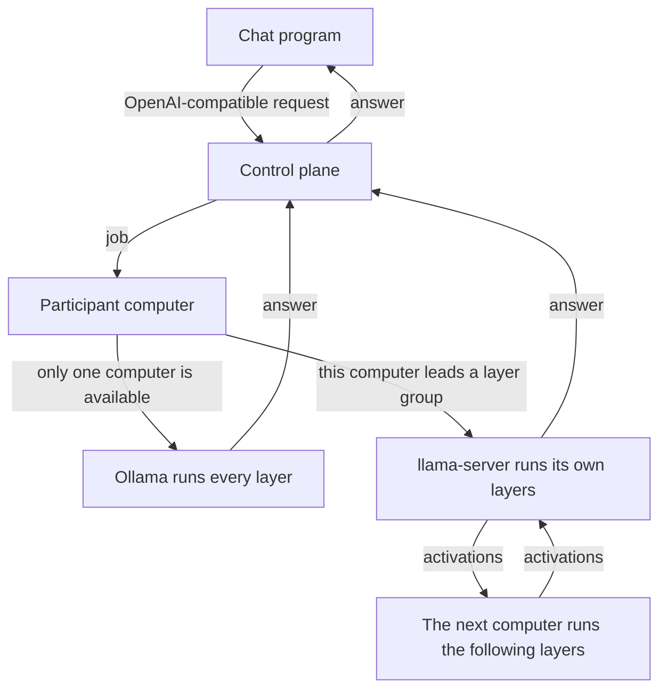

# Distributed AI Platform

[Русский](README.ru.md)

Several home computers run one model together. A model that does not fit on a single graphics card is split by layers: each computer keeps the weights on its own disk and computes only its part. A chat program talks to one OpenAI-compatible API and does not need to know which computers answered.

## How a request moves

The control plane receives the request, chooses the computers, and returns the text. It does not run the model. With one computer, that computer runs the whole model through Ollama. With two or more computers that have llama.cpp, the platform gives each one a continuous range of layers. The token walks those ranges in order. The computers connect outward to the control plane; the layer protocol is not exposed on the public internet.

Each computer downloads the model file itself. Activations move between computers. The weights are not sent again for every answer.

The Windows program installs what it needs: Ollama for a whole model, and `llama-server` plus `ggml-rpc-server` when those files are not already on the disk.

## In this repository

- [`cmd/api-gateway`](cmd/api-gateway) — the control-plane API.
- [`cmd/worker`](cmd/worker) — the program a participant runs.
- [`internal/worker`](internal/worker) — enrollment, model download, chat jobs, and layer groups.
- [`internal/store`](internal/store) — PostgreSQL, including the automatic layer layout.
- [`migrations`](migrations) — database migrations.
- [`docs/adr`](docs/adr) — architecture decisions.
- [`DISTRIBUTED_AI_PLATFORM_PLAN.md`](DISTRIBUTED_AI_PLATFORM_PLAN.md) — the full specification.

## License

The code is released under the [Apache License 2.0](LICENSE).
