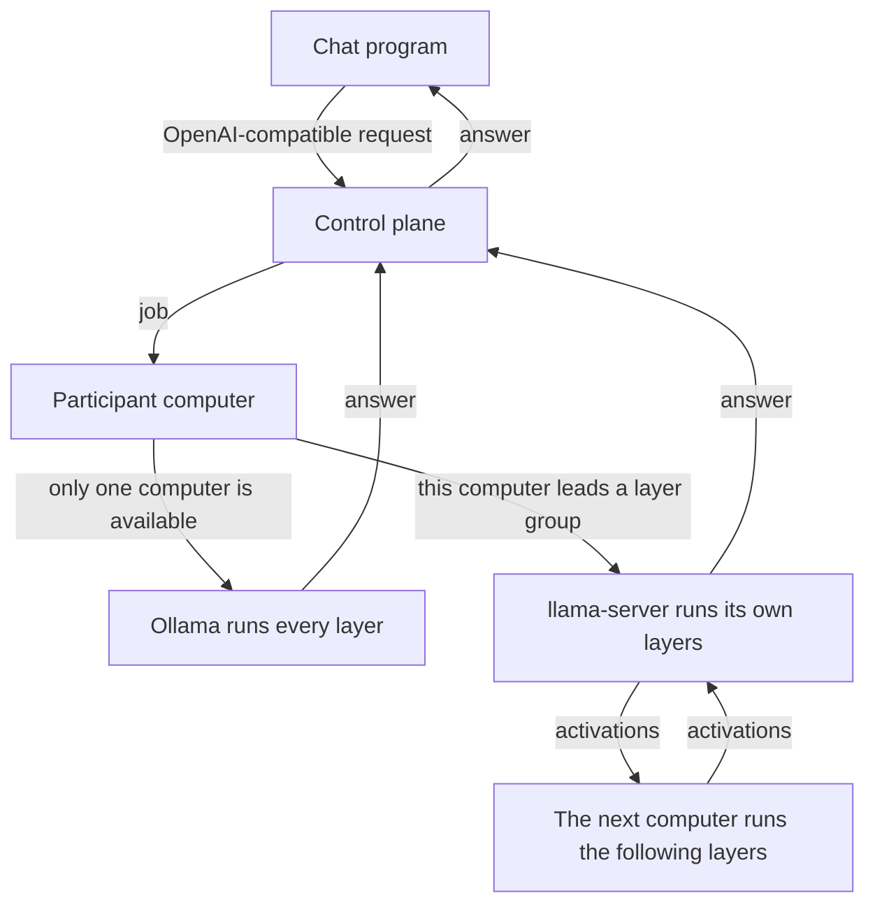

# Distributed AI Platform

[Русский](README.ru.md)

A large model does not fit on the graphics card of an ordinary home computer, so one person cannot load it or run it. In this network several such computers work together. The model is split among the participants by layers: each one contributes the power of their graphics card and space on disk, and in return can use a model that one computer cannot hold.

The chat stays with the person who sent it. That person's computer leads the answer and sees the text; the others only compute their share of the layers. A chat program talks to one OpenAI-compatible address and has no need to know which computers replied.

**Client:** [Windows](https://api.nshno.tech/node/compute-node.exe) · [Linux](https://api.nshno.tech/node/compute-node-linux)

## What to do

1. Download the program from the link above and run it. On Windows it is one file. Ubuntu Server has no window: the `setup` command does the same work, and the commands are in [`docs/linux.en.md`](docs/linux.en.md).
2. Click «Подключиться к сети» (Connect to the network). If Ollama is not installed yet, the window asks permission to download the official installer. The model cannot be downloaded without it, so the answer is yes. If Ollama is already there, the question does not appear.
3. Wait until the download finishes. The program installs llama.cpp, registers the computer, and downloads the whole model file. The status line shows the progress. Leave the window open while this runs.
4. When the connection is finished, the window shows the chat details: the API type, the base URL, the API key, and the model name. Each field has its own copy button.
5. Open a chat program that accepts an OpenAI-compatible address. Paste these fields into it and send a message. The computer running this program is the one that computes the answer, so leave it running. «Включить автозапуск» starts the program again after the computer is turned on.

An NVIDIA graphics card is required, and its driver must already be installed. This program does not install the driver.

The answer is done when the client has received the text. That answer has three numbers: tokens per second, seconds until the first token, and the share of draft tokens that were accepted. Already measured: one graphics card running the whole model gives 67.5 tok/s; two stages on one machine give 12.1 tok/s (250 tokens in 20.7 s).

The model file stays whole on every participant's disk. Each computer computes its own continuous range of layers. The principles and the two ways a request is answered are in [`docs/how-it-works.en.md`](docs/how-it-works.en.md). The same path is shorter below.

## How a request moves

The control plane receives the request, chooses the computers, and returns the text. It does not run the model. With one computer, that computer runs the whole model through Ollama. With two or more computers that have llama.cpp, the platform gives each one a continuous range of layers. The token walks those ranges in order. The computers connect outward to the control plane; the layer protocol is not exposed on the public internet.

Each computer downloads the whole model file itself. The first time a group starts, the leader sends tensors once, the stage caches them, and later tokens carry activations. The weights are not sent again for every following answer.

If the model is already in memory, it answers immediately. After the answer, and also when Disconnect is clicked, the program frees the graphics card itself. If the layer group does not start, the local model still answers.

The Windows program installs what it needs: Ollama for a whole model, and `llama-server` plus `ggml-rpc-server` from llama.cpp build b12167 when those files are not already on the disk.

Ubuntu Server does not use the window. The `setup` command installs Ollama and llama.cpp, downloads the model, and starts the service. At the end it prints the path to the file with the chat connection data: the base URL, the model name, and the API key. The full key is not printed on screen; it stays in that file. The full instructions are in [`docs/linux.en.md`](docs/linux.en.md).

## In this repository

- [`cmd/api-gateway`](cmd/api-gateway) — the control-plane API.
- [`cmd/worker`](cmd/worker) — the program a participant runs.
- [`internal/worker`](internal/worker) — enrollment, model download, chat jobs, and layer groups.
- [`internal/store`](internal/store) — PostgreSQL, including the automatic layer layout.
- [`migrations`](migrations) — database migrations.
- [`docs/how-it-works.en.md`](docs/how-it-works.en.md) — how the system works now.
- [`docs/linux.en.md`](docs/linux.en.md) — install and commands for Ubuntu Server.
- [`docs/adr`](docs/adr) — decisions recorded along the way. Where they disagree with the file above, that file wins.
- [`DISTRIBUTED_AI_PLATFORM_PLAN.md`](DISTRIBUTED_AI_PLATFORM_PLAN.md) — the original specification, not a description of the current program.

## License

The code is released under the [Apache License 2.0](LICENSE).
