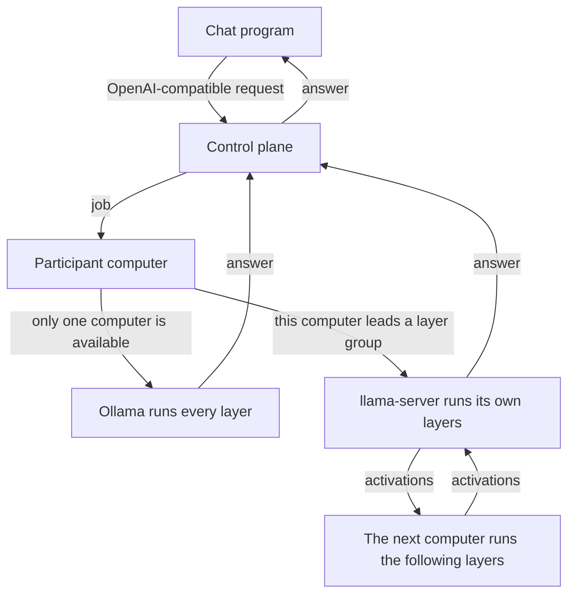

# Distributed AI Platform

[Русский](README.ru.md)

Several home computers run one model together. A model that does not fit on a single graphics card is split by layers: each computer computes one continuous range. The model file stays whole on every participant's disk. A chat program talks to one OpenAI-compatible API and does not need to know which computers answered.

The principles, the two ways a request is answered, and the technologies behind them are in [`docs/how-it-works.en.md`](docs/how-it-works.en.md). The same path is shorter below.

## How a request moves

The control plane receives the request, chooses the computers, and returns the text. It does not run the model. With one computer, that computer runs the whole model through Ollama. With two or more computers that have llama.cpp, the platform gives each one a continuous range of layers. The token walks those ranges in order. The computers connect outward to the control plane; the layer protocol is not exposed on the public internet.

Each computer downloads the whole model file itself. The first time a group starts, the leader sends tensors once, the stage caches them, and later tokens carry activations. The weights are not sent again for every following answer.

If the model is already in memory, it answers immediately. After the answer, and also when Disconnect is clicked, the program frees the graphics card itself. If the layer group does not start, the local model still answers.

The Windows program installs what it needs: Ollama for a whole model, and `llama-server` plus `ggml-rpc-server` from llama.cpp build b12167 when those files are not already on the disk.

## In this repository

- [`cmd/api-gateway`](cmd/api-gateway) — the control-plane API.
- [`cmd/worker`](cmd/worker) — the program a participant runs.
- [`internal/worker`](internal/worker) — enrollment, model download, chat jobs, and layer groups.
- [`internal/store`](internal/store) — PostgreSQL, including the automatic layer layout.
- [`migrations`](migrations) — database migrations.
- [`docs/how-it-works.en.md`](docs/how-it-works.en.md) — how the system works now.
- [`docs/adr`](docs/adr) — decisions recorded along the way. Where they disagree with the file above, that file wins.
- [`DISTRIBUTED_AI_PLATFORM_PLAN.md`](DISTRIBUTED_AI_PLATFORM_PLAN.md) — the original specification, not a description of the current program.

## License

The code is released under the [Apache License 2.0](LICENSE).
