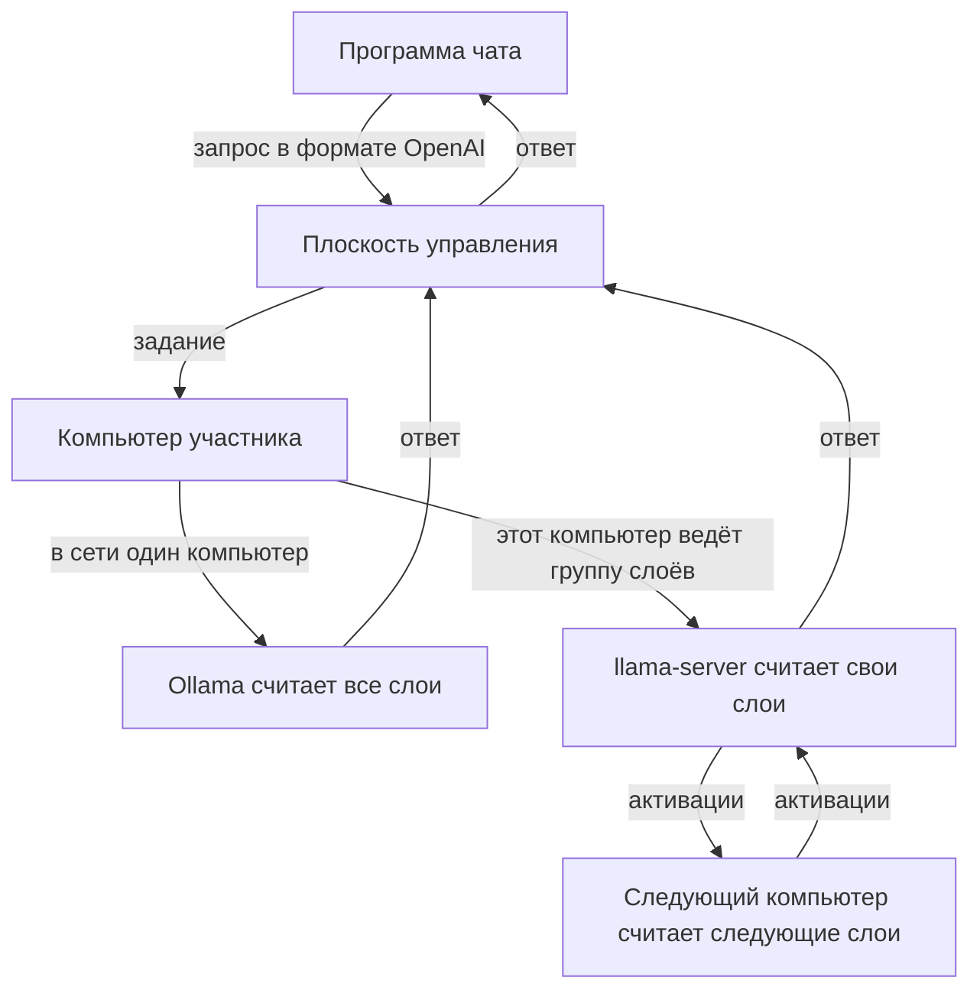

# Распределённая AI-платформа

[English](README.md)

Несколько домашних компьютеров считают одну модель вместе. Модель, которая не помещается на одну видеокарту, режется по слоям: каждый компьютер хранит веса на своём диске и считает только свою часть. Программа чата обращается к одному API, совместимому с OpenAI, и не знает, какие компьютеры ответили.

## Как проходит запрос

Плоскость управления принимает запрос, выбирает компьютеры и возвращает текст. Саму модель она не считает. Когда компьютер один, он прогоняет модель целиком через Ollama. Когда компьютеров с llama.cpp двое или больше, платформа выдаёт каждому непрерывный диапазон слоёв. Токен проходит эти диапазоны по порядку. Компьютеры сами устанавливают исходящее соединение с плоскостью управления; протокол слоёв в интернет не публикуется.

Каждый компьютер скачивает файл модели сам. Между компьютерами ходят активации. Веса заново для каждого ответа не передаются.

Программа для Windows ставит то, чего не хватает: Ollama для целой модели и `llama-server` вместе с `ggml-rpc-server`, если этих файлов ещё нет на диске.

## Что лежит в репозитории

- [`cmd/api-gateway`](cmd/api-gateway) — API плоскости управления.
- [`cmd/worker`](cmd/worker) — программа, которую запускает участник.
- [`internal/worker`](internal/worker) — регистрация, скачивание модели, задания чата и группы слоёв.
- [`internal/store`](internal/store) — PostgreSQL, в том числе автоматическая раскладка слоёв.
- [`migrations`](migrations) — миграции базы.
- [`docs/adr`](docs/adr) — архитектурные решения.
- [`DISTRIBUTED_AI_PLATFORM_PLAN.md`](DISTRIBUTED_AI_PLATFORM_PLAN.md) — полное описание.

## Лицензия

Код распространяется по [Apache License 2.0](LICENSE).
