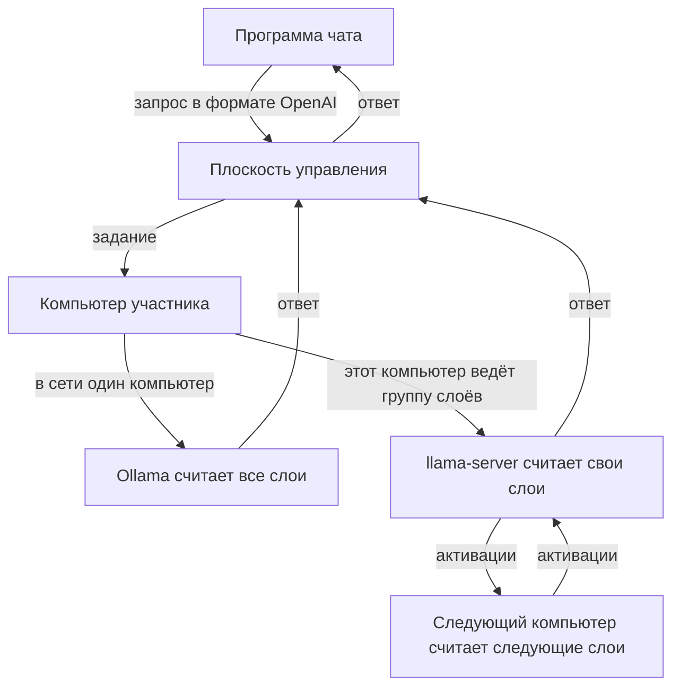

# Распределённая AI-платформа

[English](README.md)

Несколько домашних компьютеров считают одну модель вместе. Модель, которая не помещается на одну видеокарту, режется по слоям: каждый компьютер считает свой непрерывный диапазон. Файл модели при этом остаётся целым на диске каждого участника. Программа чата обращается к одному API, совместимому с OpenAI, и не знает, какие компьютеры ответили.

Принципы, два режима ответа и технологии, из которых это собрано, описаны в [`docs/how-it-works.md`](docs/how-it-works.md). Ниже — тот же путь запроса короче.

## Как проходит запрос

Плоскость управления принимает запрос, выбирает компьютеры и возвращает текст. Саму модель она не считает. Когда компьютер один, он прогоняет модель целиком через Ollama. Когда компьютеров с llama.cpp двое или больше, платформа выдаёт каждому непрерывный диапазон слоёв. Токен проходит эти диапазоны по порядку. Компьютеры сами устанавливают исходящее соединение с плоскостью управления; протокол слоёв в интернет не публикуется.

Каждый компьютер скачивает весь файл модели сам. При первом запуске группы ведущий один раз передаёт тензоры, стадия кладёт их в кэш, и дальше между компьютерами ходят активации. Для каждого следующего ответа веса заново не передаются.

Если модель уже лежит в памяти, она отвечает сразу. После ответа, а также по кнопке «Отключиться от сети», программа сама освобождает видеокарту. Если группа слоёв не стартовала, ответ всё равно даёт локальная модель.

Программа для Windows ставит то, чего не хватает: Ollama для целой модели и `llama-server` вместе с `ggml-rpc-server` сборки llama.cpp b12167, если этих файлов ещё нет на диске.

## Что лежит в репозитории

- [`cmd/api-gateway`](cmd/api-gateway) — API плоскости управления.
- [`cmd/worker`](cmd/worker) — программа, которую запускает участник.
- [`internal/worker`](internal/worker) — регистрация, скачивание модели, задания чата и группы слоёв.
- [`internal/store`](internal/store) — PostgreSQL, в том числе автоматическая раскладка слоёв.
- [`migrations`](migrations) — миграции базы.
- [`docs/how-it-works.md`](docs/how-it-works.md) — как система работает сейчас.
- [`docs/adr`](docs/adr) — решения, записанные по ходу; при расхождении с файлом выше верен он.
- [`DISTRIBUTED_AI_PLATFORM_PLAN.md`](DISTRIBUTED_AI_PLATFORM_PLAN.md) — исходное техническое задание, не описание текущей программы.

## Лицензия

Код распространяется по [Apache License 2.0](LICENSE).
