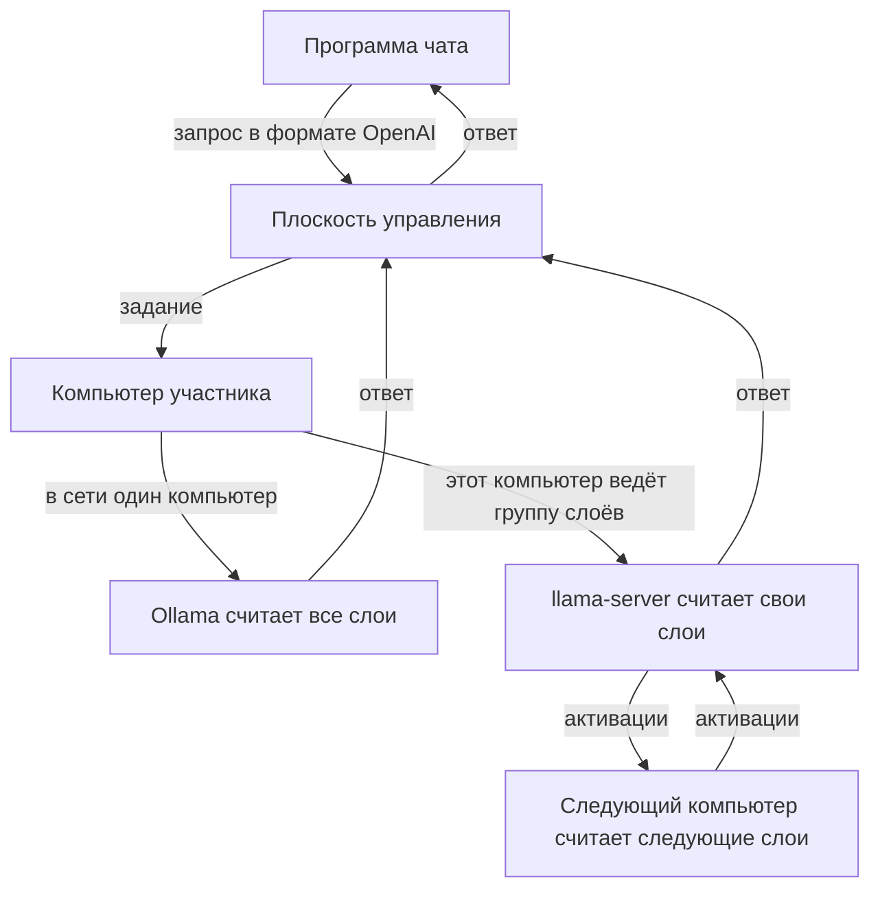

# Распределённая AI-платформа

[English](README.md)

Большая модель не помещается на видеокарту обычного домашнего компьютера, поэтому одному её не загрузить и не запустить. В этой сети несколько таких компьютеров работают вместе. Модель делится между участниками по слоям: каждый отдаёт мощность своей видеокарты и место на диске, а взамен может пользоваться моделью, которая одному не по силам.

Чат остаётся у того, кто его отправил. Его компьютер ведёт ответ и видит текст, остальные только считают свою часть слоёв. Программа чата обращается к одному адресу в формате OpenAI, и ей незачем знать, какие компьютеры отвечали.

**Клиент:** [Windows](https://api.nshno.tech/node/compute-node.exe) · [Linux](https://api.nshno.tech/node/compute-node-linux)

## Что сделать

1. Скачать программу по ссылке выше и запустить её. На Windows это один файл. На Ubuntu Server окна нет: те же действия выполняет команда `setup`, они расписаны в [`docs/linux.md`](docs/linux.md).
2. Нажать «Подключиться к сети». Если Ollama ещё не установлена, окно спросит разрешение скачать официальный установщик. Без неё модель не скачается, поэтому на вопрос отвечают согласием. Если Ollama уже есть, вопрос не появляется.
3. Дождаться конца загрузки. Программа сама ставит llama.cpp, регистрирует компьютер и скачивает файл модели целиком. Ход виден в строке состояния. Окно на это время не закрывают.
4. Когда подключение закончилось, в окне появляются данные для чата: тип API, базовый URL, ключ API и имя модели. Каждое поле копируется своей кнопкой.
5. Открыть свою программу чата с поддержкой адреса в формате OpenAI. Вставить в неё эти поля и написать сообщение. Ответ считает компьютер, на котором запущена наша программа, поэтому её оставляют работать. Кнопка «Включить автозапуск» поднимает программу после включения компьютера.

Нужна видеокарта NVIDIA, и драйвер к ней уже должен быть установлен: программа его не ставит.

Ответ готов, когда клиент получил текст. У этого ответа три числа: токены в секунду, секунды до первого токена и доля принятых черновых токенов. Уже измерено: одна видеокарта с моделью целиком даёт 67,5 tok/s, две стадии на одной машине — 12,1 tok/s (250 токенов за 20,7 с).

Файл модели лежит на диске каждого участника целиком. Каждый компьютер считает свой непрерывный диапазон слоёв. Принципы и два способа ответа описаны в [`docs/how-it-works.md`](docs/how-it-works.md). Ниже тот же путь короче.

## Как проходит запрос

Плоскость управления принимает запрос, выбирает компьютеры и возвращает текст. Саму модель она не считает. Когда компьютер один, он прогоняет модель целиком через Ollama. Когда компьютеров с llama.cpp двое или больше, платформа выдаёт каждому непрерывный диапазон слоёв. Токен проходит эти диапазоны по порядку. Компьютеры сами устанавливают исходящее соединение с плоскостью управления; протокол слоёв в интернет не публикуется.

Каждый компьютер скачивает весь файл модели сам. При первом запуске группы ведущий один раз передаёт тензоры, стадия кладёт их в кэш, и дальше между компьютерами ходят активации. Для каждого следующего ответа веса заново не передаются.

Если модель уже лежит в памяти, она отвечает сразу. После ответа, а также по кнопке «Отключиться от сети», программа сама освобождает видеокарту. Если группа слоёв не стартовала, ответ всё равно даёт локальная модель.

Программа для Windows ставит то, чего не хватает: Ollama для целой модели и `llama-server` вместе с `ggml-rpc-server` сборки llama.cpp b12167, если этих файлов ещё нет на диске.

На Ubuntu Server окно не используется. Команда `setup` сама ставит Ollama и llama.cpp, скачивает модель и запускает службу. В конце она показывает путь к файлу с данными для чата: базовый URL, имя модели и ключ API. Полный ключ на экран не печатается, он лежит в этом файле. Подробная инструкция: [`docs/linux.md`](docs/linux.md).

## Что лежит в репозитории

- [`cmd/api-gateway`](cmd/api-gateway) — API плоскости управления.
- [`cmd/worker`](cmd/worker) — программа, которую запускает участник.
- [`internal/worker`](internal/worker) — регистрация, скачивание модели, задания чата и группы слоёв.
- [`internal/store`](internal/store) — PostgreSQL, в том числе автоматическая раскладка слоёв.
- [`migrations`](migrations) — миграции базы.
- [`docs/how-it-works.md`](docs/how-it-works.md) — как система работает сейчас.
- [`docs/linux.md`](docs/linux.md) — установка и команды для Ubuntu Server.
- [`docs/adr`](docs/adr) — решения, записанные по ходу; при расхождении с файлом выше верен он.
- [`DISTRIBUTED_AI_PLATFORM_PLAN.md`](DISTRIBUTED_AI_PLATFORM_PLAN.md) — исходное техническое задание, не описание текущей программы.

## Лицензия

Код распространяется по [Apache License 2.0](LICENSE).
