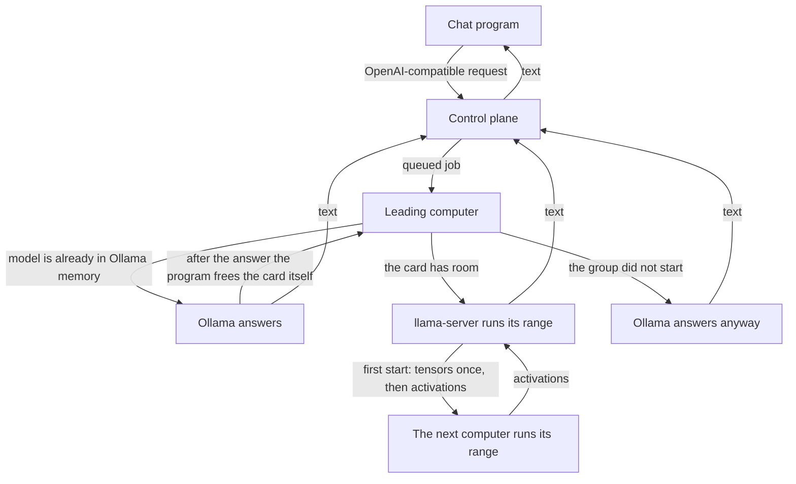

# How the system works

**This describes what the code does now** (participant program 0.3.23, 9 November 2026).
[Русский](how-it-works.md).

The original specification is [`DISTRIBUTED_AI_PLATFORM_PLAN.md`](../DISTRIBUTED_AI_PLATFORM_PLAN.md).
Decisions recorded at the time live in [`docs/adr`](adr). Measurements and the work log live in
[`STATUS.md`](STATUS.md) and [`STATUS-archive.md`](STATUS-archive.md). Where those files disagree
with this one, this file and the code are the ones that match the running system.

## Why a network

One home computer can already run a model that fits on its graphics card. The network exists
to **split one model by layers** across several computers, so a model that does not fit on a
single card can still run.

That adds capacity, not speed for one answer. Each new token walks the layers in order, and
every hop between computers is added to the time of that token. Extra full copies of the same
model speed up a queue of requests. A layer split does not speed up one answer.

While only one suitable computer is present, it runs the whole model. A layer group appears
on its own once two or more such computers are present.

## Two ways to answer

| | One computer | Layer group |
|---|---|---|
| When | Fewer than two computers have llama.cpp and the model file, the group did not start, or this computer itself reports that the file and cache fit on its card | Two or more such computers are sending heartbeats and do not report that the model fits on the card |
| What computes | Ollama, every layer on that machine | llama.cpp: `llama-server` on the leader, `ggml-rpc-server` on the others |
| What is on disk | The whole model file | The same whole file. It is not cut into pieces |

The platform splits only a model whose layer count it knows. Today that is `qwen2.5:72b-instruct-q4_0`:
80 layers. Any other model has a layer count of zero in the code and stays whole on one computer.

A group is formed like this:

1. The computer turns layer mode on by itself when llama.cpp and the Ollama weight file are already on disk. The person does not enter a layout.
2. The heartbeat reports `mesh_capable` and the model name. If the model file and room for a quantized cache fit on its largest card, it also reports `model_fits`.
3. The control plane looks at nodes that were `available` in the last two minutes, named the same model, and did not report `model_fits`.
4. Fewer than two such nodes removes the automatic group. A hand-made topology is left alone. A `model_fits` node answers its own requests whole and does not dissolve the group of the others.
5. Two or more computers produce one group per person. That person's own computer leads it: it claims the chat and sees the text. Foreign computers in the group only hold layers. A shared account is not required. Layers are split by card size, not evenly: an 8 GB card does not get the same share as a 16 GB card. If a card size is unknown, the pieces stay equal. For 24 layers and two cards of the same size the record gives the leader 0–11 and the foreign computer 12–23.

A foreign computer does not claim the job and does not see the chat text. While its own chat is idle, a computer keeps RPC up so someone else's chat can use its layers. During its own chat RPC stops: one card cannot lead an answer and serve layers at the same time.

## Path of a request

The control plane does not run the model. It accepts the request, queues a job, and returns the text.
Computers open the connection to it themselves. The layer protocol is not published: RPC listens
only on `127.0.0.1` and leaves through a tunnel the node opens.

If the model is already loaded in Ollama, the program **answers with it immediately**. It must not
unload that copy before the answer: the answer is ready, and a second copy will not fit on the same
card. After a successful answer the program stops the llama-server that belongs to Ollama and frees
the card. The next message can go through the layer group. Disconnect, pause, and exit do the
same thing at once, so the card is free to use. A llama-server started outside this program is left running.

If the group does not start because of memory or the runtime, Ollama answers **only when the file
fits this card**. A model larger than the card is not loaded whole: that is the same out-of-memory
failure, not a fallback. An error that says the prompt does not fit the context window is not
replaced this way.

An unload call to the Ollama API often never returns while its llama-server holds the card. The
program then stops only `llama-server.exe` and `llama-server-real.exe` under `\Ollama\lib\ollama\`.
It does not stop the llama.cpp build used by the layer group, and it does not stop itself.

## Weights and what crosses the network

Every participant downloads the **whole** model file through Ollama. The gigabytes shown on disk
are that file. Splitting layers does not make the file smaller. One person's download does not
change another person's disk.

llama.cpp RPC is what runs between computers:

- the first time a group starts, the leader sends tensors to the stage once, and the stage caches them (`-c`);
- later tokens carry activations, not the whole file;
- on the computer that assembles the answer, the KV cache is quantized (`--cache-type-k` and `--cache-type-v`), and a batch of `ngram-mod` drafts is checked in one hop. A model that already has a head file uses that head instead of ngram. Whether the batch is faster on this link has not been measured, so no tokens-per-second figure is promised;
- weights are not sent again for every answer while that cache is alive.

Home upload measured on this link is about **1.4–1.5 MB/s**. That is the link, not a program setting.
The first cache fill is therefore slow. A tokens-per-second figure for a live group over that link
is not given here: it has not been measured.

`research/meshpipe` is a prototype that was meant to read local blocks and send only activations.
On GPT-OSS-20B it produced 0.52 tok/s and **is not part of the product**. llama.cpp is what runs.

## What it is built from

| Part | Technology | Where in the code |
|---|---|---|
| Control plane | Go, PostgreSQL, leased jobs, heartbeats | `cmd/api-gateway`, `internal/httpapi`, `internal/store` |
| Layer layout | automatic, after a heartbeat | `internal/store/layersplit.go`, migration `0023_auto_topology.sql` |
| Participant program | Go and a Win32 window, one Windows exe | `cmd/worker` |
| Whole model | Ollama | `internal/worker/runtime.go` |
| Layer group | llama.cpp **b12167**: `llama-server` and `ggml-rpc-server` | `internal/worker/mesh.go`, `internal/worker/llama_install.go` |
| llama.cpp install | automatic, into `%LOCALAPPDATA%\ComputeNetwork\llama`; CUDA 13.4 or 12.4 from `nvidia-smi` | `internal/worker/llama_install_windows.go` |
| Panel | React and TypeScript | `web/` |
| License | Apache 2.0 | `LICENSE` |

A failed llama.cpp download does not cancel enrollment. Chat continues through Ollama.

The running system does not use NATS, S3, per-device certificates, vLLM, or Petals.
Those names belong to the original plan and the early ADRs. Petals was tried and is not used.

The program sees NVIDIA cards only, through `nvidia-smi`. The only card that has been measured
is 8 GB (8151 MiB). Nothing below that size has been measured.

Before a layer group starts, the memory check asks whether the card is free: about half the file
plus 1 GiB, never more than **6 GiB free** video memory. That mark means Ollama is no longer
holding the model, not that the whole file fits. On an 8 GB card the desktop uses about 1 GB.
A start succeeded with 6 GB free and failed with 1.7 GB free while Ollama still held the model.
Free RAM uses the same ceiling of **6 GiB**.

llama.cpp `--fit` places layers on the local card, the RPC stages, and RAM if needed. The program
does not pin GPU layers at 99. That setting stopped llama.cpp from shrinking the layout, and a
file larger than one card asked the leader for more video memory than the card has.

## Privacy

An ordinary chat is `private`. Only a node owned by the same person can claim that job.
`shared` happens when the author explicitly hands the text to the network.

Conversation history on the server is ciphertext. The key stays on the person's computer and is
not sent to the server. The control plane does not write message text to its log.
The computer that leads the answer sees the chat text. A foreign computer receives the open RPC stream, not the text. Current llama.cpp cannot hide that stream.

## What the program does by itself

- installs Ollama when it is missing;
- installs llama.cpp b12167 when `llama-server` and `ggml-rpc-server` are not already on disk;
- updates its own exe and shows the window again after a silent update;
- frees the graphics card after an answer, and also on Disconnect, pause, and exit.

On Windows the participant program is a window. On Linux the same actions are the commands `setup`, `start`, `stop`, `pause`, `resume`, `status`, and `update`. The commands are described in [`linux.en.md`](linux.en.md).
