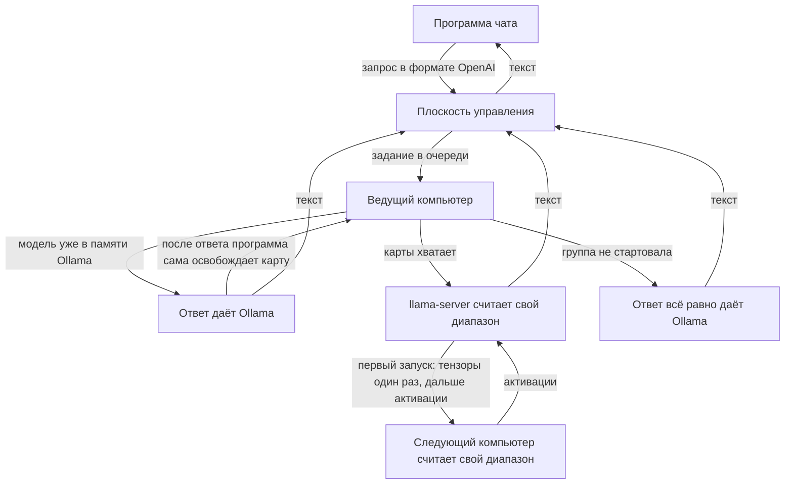

# Как устроена система

**Это описание того, что делает код сейчас** (программа участника 0.3.23, 9 ноября 2026).
[English](how-it-works.en.md).

Исходное техническое задание — [`DISTRIBUTED_AI_PLATFORM_PLAN.md`](../DISTRIBUTED_AI_PLATFORM_PLAN.md).
Записи о принятых тогда решениях — [`docs/adr`](adr). Измерения и журнал работ — [`STATUS.md`](STATUS.md)
и [`STATUS-archive.md`](STATUS-archive.md). Если эти файлы расходятся с данным, верно то, что написано здесь
и что делает код.

## Зачем сеть

Один домашний компьютер уже умеет запустить модель, которая помещается на его видеокарту.
Сеть нужна, чтобы **делить одну модель по слоям** между несколькими компьютерами и тем
самым запускать модель, которая на одну карту не помещается.

Это прибавляет ёмкость, а не скорость одного ответа. Каждый новый токен проходит слои
по порядку, и каждый переход между компьютерами добавляется ко времени токена.
Несколько отдельных копий одной и той же модели ускоряют очередь запросов. Разделение
слоёв очередь одного ответа не ускоряет.

Пока в сети один подходящий компьютер, он считает модель целиком. Группа слоёв
появляется сама, когда таких компьютеров становится два или больше.

## Два способа ответить

| | Один компьютер | Группа слоёв |
|---|---|---|
| Когда | В сети меньше двух компьютеров с llama.cpp и файлом модели, группа не стартовала, либо этот компьютер сам сообщил, что файл и кэш помещаются на его карту | Два и больше таких компьютеров присылают heartbeat и не сообщают, что модель помещается на карту |
| Чем считает | Ollama, все слои на этой машине | llama.cpp: `llama-server` у ведущего, `ggml-rpc-server` у остальных |
| Что на диске | Весь файл модели | Тот же весь файл. На части он не режется |

Платформа режет только модель, для которой знает число слоёв. Сейчас это `qwen2.5:72b-instruct-q4_0`:
80 слоёв. Для остальных моделей число слоёв в коде равно нулю, и они остаются целиком
на одном компьютере.

Группа собирается так:

1. Компьютер сам включает режим слоёв, если на диске уже есть llama.cpp и файл весов Ollama. Отдельную настройку человек не вводит.
2. В heartbeat он сообщает `mesh_capable` и имя модели. Если файл модели и запас под квантованный кэш помещаются на его самую большую карту, он дополнительно сообщает `model_fits`.
3. Плоскость управления смотрит узлы, которые за последние две минуты были `available`, назвали ту же модель и не сообщили `model_fits`.
4. Если таких узлов меньше двух, автоматическая группа снимается. Ручную топологию это не трогает. Узел с `model_fits` считает свои запросы целиком и не распускает группу остальных.
5. Если компьютеров два или больше, на каждого человека собирается своя группа. Ведёт её его собственный компьютер: он забирает его чат и видит текст. Чужие компьютеры в этой группе только держат слои. Общий аккаунт для этого не нужен. Слои режутся по объёму карт, не поровну: карте 8 ГБ не дают столько же, сколько карте 16 ГБ. Если размер карты неизвестен, куски остаются равными. Для 24 слоёв и двух карт одного размера ведущий получает 0–11, чужой — 12–23.

Чужой компьютер задание не забирает и текст чата не видит. Пока свой чат не идёт, компьютер держит RPC, чтобы чужой чат мог использовать его слои. На время своего чата RPC останавливается: одна карта не ведёт ответ и не отдаёт слои одновременно.

## Путь запроса

Плоскость управления модель не считает. Она принимает запрос, ставит задание и возвращает текст.
Компьютеры сами открывают соединение к ней. Протокол слоёв наружу не публикуется: RPC слушает
только `127.0.0.1` и выходит через туннель, который поднимает сам узел.

Если модель уже загружена в Ollama, программа **сразу отвечает ею**. Снимать её до ответа нельзя:
пока она в памяти, ответ уже готов, а вторая копия на ту же карту не встанет. После успешного
ответа программа сама останавливает llama-server из каталога Ollama и тем освобождает карту.
Следующее сообщение может идти через группу слоёв. Кнопка «Отключиться от сети», пауза
и выход из программы освобождают карту сразу, чтобы ею можно было пользоваться.
Чужой llama-server при этом не останавливается.

Если группа не стартовала из-за памяти или рантайма, ответ даёт Ollama **только когда файл помещается на эту карту**. Модель больше карты так не грузится целиком: это снова нехватка памяти, а не запасной путь. Ошибка «промпт не влезает в окно» так не подменяется.

Выгрузка через API Ollama часто не возвращается, пока её llama-server держит карту. Тогда
программа останавливает только процессы `llama-server.exe` и `llama-server-real.exe` из
`\Ollama\lib\ollama\`. Сборку llama.cpp, которой пользуется группа слоёв, и саму программу
участника она не трогает.

## Веса и то, что идёт по сети

Каждый участник скачивает **весь** файл модели через Ollama. Счётчик гигабайт на диске
показывает этот файл и не уменьшается от того, что слои разделены. Одна загрузка не меняет
диск другого человека.

Между компьютерами работает llama.cpp RPC:

- при первом запуске группы ведущий один раз передаёт тензоры стадии, и стадия кладёт их в кэш (`-c`);
- дальше по токенам ходят активации, а не весь файл;
- на компьютере, который собирает ответ, KV-кэш квантуется (`--cache-type-k` и `--cache-type-v`), а пачка черновиков `ngram-mod` проверяется за один переход. Если у модели уже есть файл головы, используется она, а не ngram. Своего замера, быстрее ли пачка на этом канале, пока нет, поэтому число tok/s здесь не обещается;
- повторно для каждого ответа веса не передаются, пока кэш жив.

Домашняя отдача, измеренная на этом канале, около **1,4–1,5 МБ/с**. Это предел канала, а не
настройка программы. Первое заполнение кэша поэтому долгое. Скорость ответа через такую сеть
отдельным числом здесь не приводится: своего замера у работающей группы нет.

В `research/meshpipe` лежит прототип, который должен читать локальные блоки и посылать только
активации. На GPT-OSS-20B он дал 0,52 tok/s и **в продукт не входит**. Сейчас считает llama.cpp.

## Из чего это собрано

| Часть | Технология | Где в коде |
|---|---|---|
| Плоскость управления | Go, PostgreSQL, очередь заданий с арендой, heartbeat | `cmd/api-gateway`, `internal/httpapi`, `internal/store` |
| Раскладка слоёв | автоматически после heartbeat | `internal/store/layersplit.go`, миграция `0023_auto_topology.sql` |
| Программа участника | Go и окно Win32, один exe для Windows | `cmd/worker` |
| Целая модель | Ollama | `internal/worker/runtime.go` |
| Группа слоёв | llama.cpp **b12167**: `llama-server` и `ggml-rpc-server` | `internal/worker/mesh.go`, `internal/worker/llama_install.go` |
| Установка llama.cpp | сама, в `%LOCALAPPDATA%\ComputeNetwork\llama`; CUDA 13.4 или 12.4 по `nvidia-smi` | `internal/worker/llama_install_windows.go` |
| Панель | React и TypeScript | `web/` |
| Лицензия | Apache 2.0 | `LICENSE` |

Ошибка скачивания llama.cpp не отменяет подключение: чат продолжается через Ollama.

В работающей системе нет NATS, S3, отдельных сертификатов устройства, vLLM и Petals.
Они есть в исходном плане и ранних ADR и туда и относятся. Petals проверен и не используется.

Видеокарты, кроме NVIDIA, программа не видит: телеметрия идёт через `nvidia-smi`.
Единственная измеренная карта — 8 ГБ (8151 МиБ). Ниже этого объёма замеров нет.

Проверка памяти перед группой слоёв смотрит, свободна ли карта: примерно половина файла
плюс 1 ГиБ, но не больше **6 ГиБ свободной** видеопамяти. Это отметка «Ollama уже не держит
модель», а не оценка, что файл влезет целиком. На карте 8 ГБ рабочий стол занимает около 1 ГБ.
Запуск проходил при 6 ГБ свободных и падал при 1,7 ГБ, когда модель ещё держала Ollama.
Свободная оперативная память считается так же с потолком **6 ГиБ**.

Слои на устройства кладёт llama.cpp `--fit`: локальная карта, RPC-стадии и при нужде RAM.
Число слоёв на GPU программа не фиксирует как 99. Иначе llama.cpp не может ужать раскладку,
и файл больше одной карты на старте просит у ведущего больше видеопамяти, чем на карте есть.

## Приватность

Обычный чат — `private`. Такое задание забирает только узел того же владельца.
`shared` бывает, когда автор явно отдал текст сети.

История диалога на сервере хранится шифротекстом. Ключ остаётся на компьютере человека
и на сервер не приходит. Плоскость управления в журнал не пишет текст сообщений.
Текст чата видит компьютер, который ведёт ответ. Чужой компьютер получает открытый поток RPC, не текст. Спрятать и этот поток текущий llama.cpp не умеет.

## Что программа делает сама

- ставит Ollama, если её нет;
- ставит llama.cpp b12167, если `llama-server` и `ggml-rpc-server` ещё не лежат на диске;
- обновляет свой exe и после тихого обновления снова показывает окно;
- сама освобождает видеокарту после ответа, а также по «Отключиться от сети», паузе и выходу из программы.

Программа участника на Windows — окно. На Linux это те же действия командами `setup`, `start`, `stop`, `pause`, `resume`, `status` и `update`. Описание команд — в [`linux.md`](linux.md).
